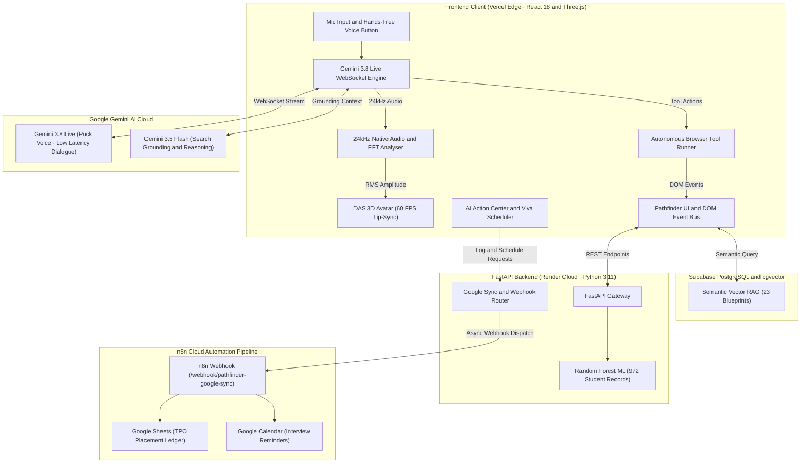

# Pathfinder 2.0 · Autonomous AI Placement Flight Controller

> **India's premier AI-powered Career Operating System for engineering candidates. Benchmarks student profiles against 972 verified campus recruitment outcomes, predicts placement odds with 88% ML precision, mentors 23 production-grade system architectures, and prepares engineers for Tier-1 recruitment filters with DAS — an autonomous 3D voice co-pilot.**

[-orange?style=for-the-badge)](https://pathfinder-client-fzom.vercel.app/?demo=1)

---

### 🌟 Live Platform Experience
👉 **[Launch Pathfinder 2.0 Live Application](https://pathfinder-client-fzom.vercel.app/?demo=1)**  
*(⚡ Instant 1-Click Access — Explore the live platform immediately with zero setup!)*

---

## 🎯 Why We Built Pathfinder 2.0 (The Problem)

Every placement season, over **80% of engineering candidates struggle to land high-paying Tier-1 offers** due to four systemic roadblocks:

1. **The ATS Filter Black Hole**: Over 75% of resumes are discarded by Applicant Tracking Systems within seconds because of poor formatting, generic buzzwords, and lack of quantifiable achievements.
2. **The "Toy Project" Barrier**: Tutorial clones (to-do lists, basic calculators, simple e-commerce templates) collapse the moment recruiters ask about production design, distributed caching, database indexing, or failover strategies.
3. **Architecture Defense & Viva Anxiety**: Memorizing code algorithms is no longer enough. Modern hiring requires candidates to defend system trade-offs using the STAR method under live pressure.
4. **Blind Applications Without Benchmarks**: Students apply to companies with no objective data regarding their placement probability, branch-specific cutoffs, or peer competitiveness.

**Pathfinder 2.0 eliminates this uncertainty by providing a flight-controller dashboard that benchmarks your skills against real placement data and prepares you for real-world interviews.**

---

## 💡 What We Built (The Solution)

Pathfinder 2.0 is an end-to-end Career Operating System powered by predictive data science and Google Gemini AI:

- **Predictive Placement Engine**: Predicts placement odds and expected CTC packages with 88% precision using a Random Forest model calibrated on 972 verified campus outcomes.
- **DAS 3D Voice Co-Pilot**: An interactive cybernetic mentor with real-time 60 FPS jaw lip-sync powered by **Google Gemini 3.8 Live** and the **Puck** neural voice. Supports hands-free voice commands to navigate the platform.
- **23 Production-Grade Blueprints**: Industry-vetted system architectures (Enterprise RAG engines, distributed queues, real-time collaboration engines, IoT telemetry, computer vision pipelines) that give engineering portfolios genuine depth.
- **1-Page ATS Resume Studio**: An automated resume builder enforcing the Google X-Y-Z achievement formula to ensure zero drop-off through recruiter screening algorithms.
- **Technical Defense Simulator**: Interactive viva sparring partner that tests your architectural choices and STAR-format defense before real interviews.
- **Automated Google Workspace Sync**: Non-blocking cloud automation powered by n8n to sync placement readiness scores directly to TPO Google Sheets and schedule mock viva sessions on Google Calendar.

---

## 🚀 Why You Should Use Pathfinder 2.0 (Key Benefits)

| User Group | Core Advantage | Real-World Impact |
| :--- | :--- | :--- |
| **Engineering Students** | Objective placement benchmarking & hands-free voice co-pilot. | Know your real odds, build production systems, and pass tough viva rounds. |
| **Placement Cells (TPOs)** | Real-time cohort analytics & automated Google Sheets tracking. | Automated student governance, NAAC 5.2 data compliance, and skill diagnostics. |
| **Technical Recruiters** | Verified architectural competence and production depth. | Filter candidates by proven system design defense rather than memorized syntax. |

---

## 🏗️ Full-Stack System Architecture

The platform operates on a high-speed, modern full-stack architecture uniting **Vercel**, **Google Gemini AI**, **FastAPI on Render**, **Supabase pgvector**, and **n8n Cloud**:

---

## 🛠️ Technologies & Tools Used

- **Frontend Edge**: React 18, TypeScript, Three.js, Tailwind CSS, Lucide Icons, Web Audio API (60 FPS RMS Analyser).
- **AI Brain & Voice**: Google Gemini 3.8 Live (`gemini-3.8-live`), Puck neural voice, Google GenAI SDK (`@google/genai`), Google Gemini 3.5 Flash (Search Grounding).
- **Backend & ML**: Python 3.11, FastAPI, Uvicorn, Scikit-Learn (Random Forest Classifier on 972 student records), Pydantic v2.
- **Database & RAG**: Supabase PostgreSQL, `pgvector` semantic vector store, 384-dimensional embeddings.
- **Cloud Automation**: n8n Cloud Webhook Workflow, Google Sheets API v4, Google Calendar API v3.
- **Hosting & Infrastructure**: Vercel (Frontend Client), Render (FastAPI Backend Service), GitHub Actions.

---

## ☁️ Cloud Deployment & Environment Variables

### 1. 🌐 Vercel Dashboard (Frontend Client)
- **Live URL**: [https://pathfinder-client-fzom.vercel.app](https://pathfinder-client-fzom.vercel.app)
- Configure these variables under **Vercel Project Settings → Environment Variables**:

| Variable Name | Value / Description | Required |
| :--- | :--- | :---: |
| `VITE_API_BASE_URL` | `https://pathfinder-backend-klrp.onrender.com` | **Yes** |
| `VITE_GEMINI_API_KEY` | Your Google Gemini API Key | **Yes** |
| `VITE_GEMINI_LIVE_MODEL` | `gemini-3.8-live` | **Yes** |
| `VITE_GEMINI_MODEL` | `gemini-3.5-flash` | **Yes** |
| `VITE_GEMINI_VOICE_NAME` | `Puck` | **Yes** |
| `VITE_SUPABASE_URL` | `https://fenalqckgkqzyhovlyrb.supabase.co` | **Yes** |
| `VITE_SUPABASE_ANON_KEY` | Your Supabase publishable anon key | **Yes** |

---

### 2. ⚙️ Render Dashboard (Backend Web Service)
- **Live URL**: [https://pathfinder-backend-klrp.onrender.com](https://pathfinder-backend-klrp.onrender.com)
- Configure these variables under **Render Service Settings → Environment Variables**:

| Variable Name | Value / Description | Required |
| :--- | :--- | :---: |
| `PORT` | `8000` | **Yes** |
| `HOST` | `0.0.0.0` | **Yes** |
| `BACKEND_URL` | `https://pathfinder-backend-klrp.onrender.com` | **Yes** |
| `FRONTEND_URL` | `https://pathfinder-client-fzom.vercel.app` | **Yes** |
| `GEMINI_API_KEY` | Your Google Gemini API Key | **Yes** |
| `GEMINI_MODEL` | `gemini-3.5-flash` | **Yes** |
| `GEMINI_LIVE_MODEL` | `gemini-3.8-live` | **Yes** |
| `GEMINI_VOICE_NAME` | `Puck` | **Yes** |
| `GEMINI_FALLBACK_MODEL` | `gemini-3.1-flash-lite` | **Yes** |
| `SUPABASE_URL` | `https://fenalqckgkqzyhovlyrb.supabase.co` | **Yes** |
| `SUPABASE_ANON_KEY` | Your Supabase publishable anon key | **Yes** |
| `SUPABASE_SERVICE_ROLE_KEY` | Your Supabase service role key | Optional |
| `N8N_WEBHOOK_URL` | `https://dileepdas.app.n8n.cloud/webhook/pathfinder-google-sync` | **Yes** |
| `JWT_SECRET` | 32+ character secure secret string | **Yes** |
| `OWNER_EMAIL` | `dileepbommali16@gmail.com,dileep@pathfinder.ai,dileep` | **Yes** |

---

## 👑 Founder & Lead Architect

Pathfinder 2.0 was conceived, designed, and engineered by:

**Dileep Bommali**  
*Lead Architect, Founder & Full-Stack AI Engineer*  
- **Email**: [dileepbommali16@gmail.com](mailto:dileepbommali16@gmail.com)  
- **Platform**: [Pathfinder 2.0 Live Platform](https://pathfinder-client-fzom.vercel.app/?demo=1)

---

## 📜 License

This project is licensed under the [MIT License](LICENSE).
