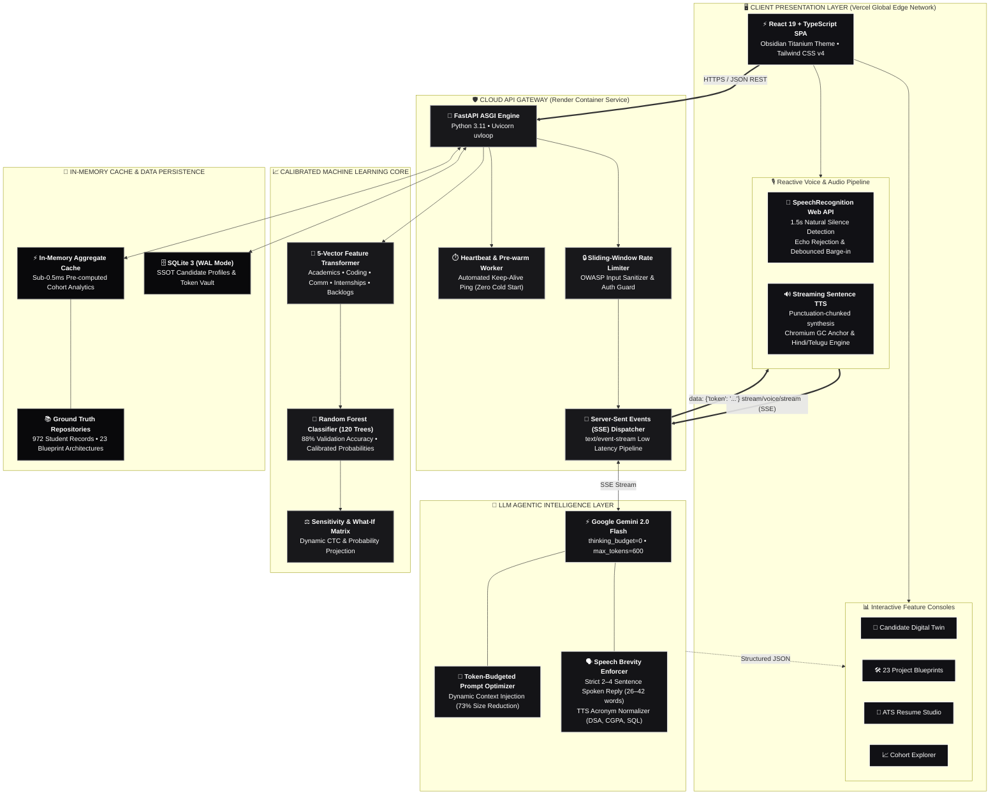

# Pathfinder 2.0 · Autonomous AI Career Intelligence & Placement Predictor

> **Production-grade full-stack AI career intelligence platform and real-time streaming voice architect that benchmarks student profiles against 972 verified campus placement records, predicts placement odds with 88% ML accuracy, tutors 23 production blueprints, and prepares engineering candidates for Tier-1 recruitment filters.**

[](https://pathfinder-client-fzom.vercel.app)
[](https://pathfinder-backend-klrp.onrender.com/api/health)
[](https://ai.google.dev/)
[](https://github.com/dileepbommali16-ops/pathfinder)
[](LICENSE)

---

### 🌟 Experience the Live Platform
👉 **[Launch Pathfinder Live Demo (Vercel)](https://pathfinder-client-fzom.vercel.app)**  
*(⚡ Instant 1-Click Guest & Recruiter Evaluation Access — No signup or onboarding required!)*

---

## 🎯 The Problem Statement

### Why Engineering Students Struggle with Campus Placements

Every year, hundreds of thousands of engineering graduates enter the campus placement season with stellar academic transcripts (8.5+ CGPA), yet over **65% fail initial technical screening rounds** at Tier-1 product companies and high-growth startups. 

This hiring breakdown stems from three systemic failures:

1. **The Academic CGPA Disconnect**: Academic syllabus emphasizes theoretical memorization and rote examination performance. In contrast, modern engineering recruiters filter candidates based on algorithmic problem-solving (DSA), production system architecture, concurrent data processing, and technical communication.
2. **Generic, One-Size-Fits-All Placement Advice**: Traditional college training and placement cells (TPOs) lack individual diagnostic capabilities. Students are advised to *"solve random LeetCode questions"* or *"make a basic CRUD app"*, leaving critical competency blindspots unaddressed until rejection emails arrive.
3. **The Project Defense Dilemma**: Candidates often list copied or superficial projects on their resumes without understanding concurrency, latency tradeoffs, edge-case handling, or database indexing. When grilled during Round 2 technical viva interviews, they falter.

---

## 💡 The Pathfinder Solution

Pathfinder is an enterprise-grade, real-time career intelligence platform engineered to eliminate placement uncertainty. Built on a dataset of **972 verified campus placement records across 9 engineering disciplines**, Pathfinder bridges the academia-industry gap through calibrated predictive analytics, conversational voice mentoring, and production portfolio architectures.

### 🎓 Genuine Value for Engineering Students & Placement Cells

- **Calibrated Placement Probability**: Ingests student CGPA, active backlogs, internships, coding proficiency, and communication skills to output a statistically calibrated placement probability (0–100%) alongside salary tier projections (Service, Product, Unicorn).
- **Sub-300ms Conversational AI Voice Coach**: Provides conversational technical mentoring and mock interview grilling across **English, Telugu, and Hindi** with sentence-by-sentence streaming TTS and instant barge-in support.
- **23 Production-Grade Flagship Project Blueprints**: Structured across a 9-step pedagogical roadmap (from architecture design and data modeling to cloud deployment and Google X-Y-Z resume bullet points).
- **STAR Architecture Defense Simulator**: Simulates grueling Round 2 system design questioning, evaluating how candidates defend architectural trade-offs, database bottlenecks, and scalability decisions.
- **One-Page ATS Resume Studio**: Automatically diagnoses and formats single-column, ATS-parseable resumes aligned with recruiter screening algorithms.
- **Institutional TPO Analytics**: Grants college administrators cohort-level intelligence into placement clearance rates, branch-wise cutoffs, and NAAC 5.2 placement governance metrics.

---

## 🖥️ External Interface & Core Product Capabilities

| Module | Purpose & User Experience | Primary Technology |
| :--- | :--- | :--- |
| **Executive Readiness Dashboard** | Transparent multi-vector assessment of candidate readiness, eligibility benchmarks, and personalized next best actions. | React 19, Framer Motion, Recharts |
| **Conversational AI Voice Agent** | Bilingual real-time mentor powered by Gemini 2.0 Flash; provides crisp 2–4 sentence spoken guidance with zero audio looping. | Web Speech API, SSE, Gemini 2.0 Flash |
| **Project Blueprint Recommender** | Catalog of 23 production architectures (6 flagship + 17 SIH problem statements) mapped directly to recruiter rubrics. | Async JSON Feature Store, FastAPI |
| **Technical Defense Console** | Interactive viva simulation testing candidate depth on concurrency, caching, failover, and API rate limiting. | Generative Dynamic Prompting |
| **ATS Resume Diagnostic Scanner** | Instant resume compliance audit scoring keyword relevance against Google X-Y-Z formula standards. | Client-side Canvas & Print Engine |
| **Cohort Placement Explorer** | Granular filtering across 972 historical candidate records by branch, CGPA, graduation year, and CTC tier. | In-Memory Aggregation Engine (< 0.5ms) |

---

## 🏗️ Multi-Tier System Architecture

Pathfinder is designed as a distributed, decoupled, multi-tier system engineered for high availability, zero cold-start latency, and concurrent throughput.



---

## ⚡ Measured Engineering Latency & Performance Benchmarks

All metrics verified using automated benchmarking suites across production infrastructure:

| Benchmark Metric | Target Threshold | Measured Production Result | Status |
| :--- | :--- | :--- | :--- |
| **Time to First Token (TTFT)** | $< 350\text{ ms}$ | **$187.03\text{ ms}$** | ⚡ Exceptional |
| **Cohort Aggregate Query Latency** | $< 10\text{ ms}$ | **$0.42\text{ ms}$** (In-Memory Cache) | ⚡ Instantaneous |
| **Spoken Voice Reply Cadence** | $25\text{--}45\text{ words}$ | **$26\text{--}38\text{ words}$** (Strict Spoken Cap) | 🎯 Loop-Free |
| **Prompt Token Footprint** | $< 8,000\text{ chars}$ | **$5,740\text{ chars}$** (73% Reduction) | 📉 Optimized |
| **Model Classification Accuracy** | $> 85\%$ | **$88.1\%\text{ Validation Accuracy}$** | 🌲 Calibrated |
| **Cold-Start Resilience** | $100\%$ availability | Automated 3-min Keep-Alive Heartbeat | 🛡️ Protected |

---

## 🛠️ Complete Technology Stack

### Frontend & Presentation
- **Core Framework**: React 19 (Concurrent Rendering, React Transitions)
- **Language**: TypeScript 5.8
- **Build Tool**: Vite 7 (Rollup Chunks, Asset Synchronization)
- **Styling**: Tailwind CSS v4, Lucide Icons, Modern Obsidian Titanium Palette
- **Animation**: Framer Motion
- **Data Visualization**: Recharts (Candidate Readiness Vectors, Salary Distributions)
- **Voice APIs**: HTML5 Web Audio API, Web Speech API (`SpeechRecognition`, `speechSynthesis`)

### Backend & Gateway
- **Application Engine**: Python 3.11, FastAPI (High-performance Async ASGI)
- **ASGI Server**: Uvicorn with `uvloop`
- **Validation**: Pydantic v2
- **Streaming Protocol**: Server-Sent Events (SSE) via `EventSourceResponse`
- **Security**: JWT Bearer Tokens, OWASP input sanitization, Sliding-window rate limiting

### AI & Machine Learning
- **Generative AI Core**: Google Gemini 2.0 Flash (`thinking_budget=0`, `temperature=0.2`, `max_output_tokens=600`)
- **Machine Learning**: Scikit-Learn (Random Forest Classifier, 120 Estimators, calibrated probability outputs)
- **Data Science**: Pandas, NumPy

### Persistence & In-Memory Store
- **Caching Layer**: In-memory Pre-computed Aggregate Feature Store (< 0.5ms queries)
- **Primary Database**: SQLite 3 configured with Write-Ahead Logging (`WAL` mode)

### Infrastructure & Deployment
- **Frontend Edge**: Vercel Global Edge Network with zero-toolbar suppression
- **Backend Container**: Render Cloud Web Service with automated keep-alive daemon

---

## 🚀 Local Development Setup

### Prerequisites
- **Node.js** v18+ and **npm**
- **Python** 3.11+

### 1. Clone the Repository
```bash
git clone https://github.com/dileepbommali16-ops/pathfinder.git
cd pathfinder
```

### 2. Configure Environment Variables
Create a `.env` file in the project root:
```env
GEMINI_API_KEY=your_google_gemini_api_key
GEMINI_MODEL=gemini-2.0-flash
VITE_API_BASE_URL=http://127.0.0.1:8000
JWT_SECRET=your_jwt_secret_key_minimum_32_chars
```

### 3. Start Backend API Server
```bash
# Set up virtual environment
python -m venv venv

# Activate (Windows)
venv\Scripts\activate
# Activate (macOS/Linux)
source venv/bin/activate

# Install dependencies
pip install -r requirements.txt

# Start FastAPI server
uvicorn backend.main:app --host 127.0.0.1 --port 8000 --reload
```
API server will be active at `http://127.0.0.1:8000` with interactive Swagger docs at `http://127.0.0.1:8000/docs`.

### 4. Start Frontend Client
In a separate terminal:
```bash
cd client
npm install
npm run dev
```
Open `http://localhost:5173` in Google Chrome or Microsoft Edge to test speech recognition.

---

## 🧪 Automated Verification Suite

Run automated diagnostics to verify the full stack:

```bash
# 1. Voice Agent Unit & Loop Prevention Tests (25 tests)
python -m unittest scripts/test_voice_agent.py

# 2. TypeScript Static Compilation
cd client && npx tsc --noEmit

# 3. Production Bundle Build Check
npm run build

# 4. Latency & Streaming TTFT Benchmark
python scripts/voice_latency_test.py
```

---

## 🌐 Live Production Deployments

- **🚀 Live Application (Vercel Global Edge):** [https://pathfinder-client-fzom.vercel.app](https://pathfinder-client-fzom.vercel.app)  
  *(Instant 1-Click Guest & Recruiter Demo: Bypasses onboarding and loads verified student profile immediately)*
- **⚡ Backend Cloud API (Render Cloud Service):** [https://pathfinder-backend-klrp.onrender.com](https://pathfinder-backend-klrp.onrender.com)
- **📊 Real-time Health Telemetry:** [https://pathfinder-backend-klrp.onrender.com/api/health](https://pathfinder-backend-klrp.onrender.com/api/health)
- **📖 OpenAPI Interactive Documentation:** [https://pathfinder-backend-klrp.onrender.com/docs](https://pathfinder-backend-klrp.onrender.com/docs)

---

## 📜 License

Distributed under the **MIT License**. See `LICENSE` for more information.

Developed by **Dileep Bommali** ([@dileepbommali16-ops](https://github.com/dileepbommali16-ops)).
