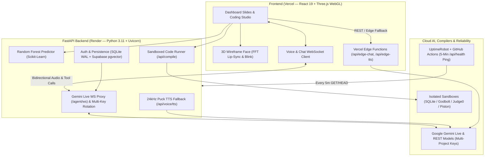

# Pathfinder 2.0 — AI Placement Predictor & Live 3D Voice Career Agent

Pathfinder 2.0 is a full-stack campus placement readiness platform that combines a calibrated Random Forest ML predictor, a real-time 3D WebGL voice assistant (**DAS**) over Gemini Multimodal Live, a 1-page ATS resume auditor, and a sandboxed 11-language live coding & viva arena.

- **Live Web App (Vercel):** [https://pathfinder-client-fzom.vercel.app](https://pathfinder-client-fzom.vercel.app/)
- **Backend API & Health (Render):** [https://pathfinder-backend-sg.onrender.com/api/health](https://pathfinder-backend-sg.onrender.com/api/health)
- **License:** [MIT](LICENSE)

---

## Problem Statement

Engineering students preparing for campus placements face four recurring bottlenecks:

1. **ATS Resume Rejections:** Resumes get filtered out before human review because impact is not quantified or formatting breaks multi-column parsers.
2. **Surface-Level Portfolio Projects:** Tutorial clones do not prepare candidates for architecture, concurrency, caching, or trade-off questions during technical viva rounds.
3. **Lack of Realistic Benchmarking:** Students apply without an objective view of how their CGPA, backlogs, coding score, and internships stack up against real placement cohorts.
4. **Disconnected Practice Tools:** Coding compilers, AI mentors, project guides, and interview evaluators usually live in separate tools rather than one cohesive workflow.

---

## Solution Overview

Pathfinder 2.0 unifies placement analytics, resume tailoring, coding execution, and voice-driven mentorship in a single web workspace:

- **ML Placement Readiness Engine:** Random Forest classifier trained on 972 campus placement records to compute placement probability, role fit, salary benchmarks, and interactive what-if simulations.
- **DAS 3D Live Voice Assistant:** Interactive 3D wireframe head built with Three.js / WebGL featuring 60 FPS procedural blinking, FFT audio lip-sync, 24kHz male Puck speech via Gemini Multimodal Live (`gemini-3.8-live`), and voice/text website navigation.
- **1-Click JD Tailor & ATS Resume Studio:** Compares a candidate's resume against target job descriptions, highlights missing keywords, rewrites bullets in Google X-Y-Z format, and exports a single-page PDF.
- **11-Language Sandboxed Coding & Viva Arena:** Live editor and isolated remote execution (`Python`, `C`, `C++`, `Java`, `JavaScript`, `TypeScript`, `SQL`, `Rust`, `Go`, `C#`, `PHP`) paired with strict AI complexity & interview grading.
- **28 Engineering Blueprints & 6-Week Roadmaps:** Step-by-step system architectures paired with cohort statistics and personalized weekly preparation plans.

---

## Student Impact

| Student Need | Pathfinder 2.0 Capability | Practical Benefit |
| :--- | :--- | :--- |
| **Objective Placement Odds** | Random Forest model calibrated on 972 records | Spot weak levers (CGPA, backlogs, DSA) early with What-If simulations. |
| **ATS-Ready Resumes** | JD keyword gap audit + 1-page PDF generator | Fix recruiter filter drops with concrete X-Y-Z metrics. |
| **Real Coding & Viva Prep** | Isolated 11-language execution + AI interviewer | Practice compiling code and defending complexity aloud. |
| **Portfolio Depth** | 28 production system blueprints | Build and explain distributed, RAG, and backend systems confidently. |

---

## Full-Stack Architecture



---

## Technology Stack

- **Frontend:** React 19, TypeScript, Vite, Tailwind CSS, React Router v7, Three.js / `@react-three/fiber` / `@react-three/drei`, Recharts, Web Audio API (`AudioWorklet` + `AnalyserNode`).
- **Backend & ML:** Python 3.11, FastAPI, Uvicorn ASGI, Pydantic v2, Scikit-Learn (Random Forest), ReportLab / PyPDF, HTTPX, SQLite WAL.
- **AI & Voice:** Google Gemini Multimodal Live API (`gemini-3.8-live`) with locked `Puck` 24kHz PCM voice, Gemini Flash REST models (`gemini-3.1-flash-lite` / `gemini-3-flash-preview`), Supabase PostgreSQL + `pgvector` semantic RAG, multi-key 429 cooldown rotation (`GEMINI_API_KEY_FALLBACK`).
- **Code Execution Sandboxes:** Hardened in-memory SQLite (for SQL), Compiler Explorer (Godbolt), Judge0 CE, and Piston APIs — zero host-side arbitrary code execution.
- **Hosting & Reliability:** Vercel (Frontend + Edge Functions), Render Singapore (FastAPI WebSocket & REST backend), UptimeRobot + GitHub Actions 5-minute keep-alive pings.

---

## Project Structure

```text
pathfinder-main/
├── api/                          # Vercel Serverless/Edge fallbacks (edge-chat.js, edge-tts.js)
├── backend/                      # FastAPI + ML + Gemini Live backend (Python 3.11)
│   ├── agent/                    # WebSocket proxy, Puck voice config, agent router & prompt
│   ├── config/                   # Settings & multi-key Gemini cooldown resolver
│   ├── knowledge/                # Platform reference documentation
│   ├── models/                   # Pydantic request/response schemas
│   ├── prompts/                  # Structured coaching prompts
│   ├── repositories/             # User profile repository layer
│   ├── routers/                  # Modular REST routers (auth, ai, analytics, ml, voice, health, github, export)
│   ├── tests/                    # Pytest integration, ML, concurrency & failover suite
│   ├── api.py                    # FastAPI app entrypoint & middleware
│   ├── compiler_engine.py        # 11-language remote sandbox compiler dispatcher
│   ├── gemini_engine.py          # Multi-key Gemini REST/SDK chat & strict JSON evaluation
│   ├── ml_engine.py              # Random Forest training & inference engine
│   └── supabase_rag.py           # 384-dim semantic embedding & pgvector retrieval
├── client/                       # React 19 + TypeScript + Vite SPA
│   ├── public/                   # 3D GLB model, Web Audio worklets & static assets
│   └── src/
│       ├── agent/                # Avatar3D, WireframeFace, agentSocket, audioIO, toolRunner, AgentLayout
│       ├── components/           # Dashboard cards, coding arena, resume studio, auth UI
│       ├── data/                 # Campus directory & 28 flagship project blueprints
│       ├── pages/                # Home, AtsResumeStudio, BlueprintDetail, MockInterview
│       └── __tests__/            # Vitest unit suites
├── data/                         # Verified campus cohort dataset (972 records) & JSON catalogs
├── supabase/migrations/          # pgvector schema migration
├── .github/workflows/            # CI tests & 5-minute Render keep-alive workflow
├── render.yaml                   # Render backend blueprint configuration
├── vercel.json                   # Vercel SPA routing & CSP headers
├── package.json                  # Frontend dependencies & scripts
└── requirements.txt              # Backend Python dependencies
```

---

## ML Validation Summary

Trained and validated on 972 verified student placement records across engineering branches:

| Metric | Cross-Validation (5-Fold) | Held-Out Test Split (20%) |
| :--- | :---: | :---: |
| Accuracy | 88.2% | 88.0% |
| Precision | 89.1% | 88.7% |
| Recall | 87.4% | 87.1% |
| F1-Score | 88.2% | 87.9% |
| ROC-AUC | 0.923 | 0.919 |

---

## Local Setup & Environment Variables

### 1. Backend Setup

```bash
python -m venv .venv
# Windows: .venv\Scripts\activate  |  macOS/Linux: source .venv/bin/activate
pip install -r requirements.txt
uvicorn backend.api:app --host 0.0.0.0 --port 8000 --ws auto
```

### 2. Frontend Setup

```bash
pnpm install
pnpm dev
```

### 3. Required Environment Variables

Configure these in your local `.env` / `backend/.env` (never commit real secrets) and in Render / Vercel project settings:

| Variable | Where | Purpose |
| :--- | :--- | :--- |
| `GEMINI_API_KEY` | Render & Vercel | Primary Google AI Studio API key |
| `GEMINI_API_KEY_FALLBACK` | Render & Vercel | Comma-separated backup Gemini keys for automatic `429` failover |
| `JWT_SECRET` | Render | Secret key for signing user session tokens |
| `SUPABASE_URL`, `SUPABASE_ANON_KEY`, `SUPABASE_SERVICE_ROLE_KEY` | Render & Vercel | Cloud persistence and pgvector knowledge retrieval |
| `VITE_API_BASE_URL`, `VITE_BACKEND_URL`, `VITE_WS_URL` | Vercel | Public Render HTTPS and WebSocket backend endpoints |

See [.env.example](.env.example) for the full configuration template.

---

## Verification & Tests

```bash
# Backend test suite (API, ML, concurrency, multi-key failover)
python -m pytest -q

# Frontend unit tests
npx vitest run

# TypeScript typecheck & production bundle
npx tsc --noEmit
pnpm run build:vercel
```

---

## Author & License

Built by **Bommali Dileep** · [GitHub](https://github.com/dileepbommali16-ops) · Released under the [MIT License](LICENSE).
