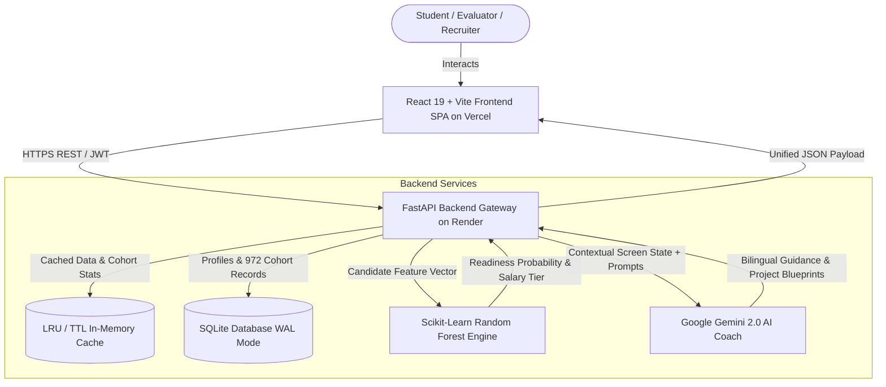

# Pathfinder 2.0

> **An AI career co-pilot that analyzes student skills and projects to predict campus placement odds and generate custom interview roadmaps in seconds.**

[](https://pathfinder-client-fzom.vercel.app)
[](https://pathfinder-backend-klrp.onrender.com/api/health)
[](https://github.com/dileepbommali16-ops/pathfinder)
[](LICENSE)

### 🌟 Experience the Live Platform
👉 **[Launch Pathfinder Live Demo (Vercel)](https://pathfinder-client-fzom.vercel.app)**  
*(Instant guest demo access available — no signup required for evaluators, stakeholders, and visitors!)*

---

## 🎯 Problem Statement

Engineering students often struggle to gauge their true placement readiness because academic CGPA alone does not reflect modern technical recruitment cutoffs. Furthermore, career guidance in campus placement cells is frequently generic, siloed, and disconnected from historical hiring data and individual skill gaps. 

Pathfinder bridges this gap by translating academic records, verified technical skills, and project portfolios into actionable placement readiness probabilities, personalized gap-closure roadmaps, and contextual AI-powered mentorship.

---

## 🌟 Key Platform Features

- **ML Placement Readiness Prediction:** Calibrated Random Forest inference engine trained on **972 historical student placement records** across **9 engineering branches**, providing candidate placement probabilities, salary tier projections, and model confidence scores.
- **Screen-Aware Bilingual AI Coach:** Context-aware Google Gemini assistant offering tailored technical interview preparation, resume critiques, and personalized mentorship in English and Telugu (`నమస్కారం! / Roman Telugu`). The AI mentor dynamically reads the user's active tab, gauge metrics, and specific card context.
- **Skill Gap & Career Roadmap Engine:** Automated skill delta analysis evaluating student proficiencies against 14+ target technical roles to construct semester-by-semester 6-week learning paths and tactical mission sprints.
- **Interactive Cohort Analytics:** Institutional dashboard visualizing placement trends, branch-wise cutoffs, package distributions, and skill matrices across 972 historical student records.
- **23 Production Architecture Blueprints:** Comprehensive catalog of software, hardware, and deep-tech portfolio projects (6 flagship architectures + 17 Smart India Hackathon blueprints) complete with system diagrams, implementation milestones, pitfalls to avoid, and viva defense Q&A.
- **Interactive Lamp Login (Zero-Blockage Accessibility):** Elegant desk lamp authentication experience with pull string cord, hardware-accelerated ambient lighting particles, default illumination, one-click radiance toggle, and instant guest demo access so no evaluator or friend is ever blocked.
- **Enterprise Security & Hybrid Auth:** Multi-tenant session management supporting JWT bearer tokens, instant guest demo access, and OAuth 2.0 (Google and GitHub) with IDOR protection.

---

## 💻 Tech Stack

| Layer | Technologies |
| :--- | :--- |
| **Frontend** | React 19, TypeScript, Vite 7, Tailwind CSS v4, Lucide Icons, Recharts, Framer Motion, ThreeUI (Predictive Arc WebGL) |
| **Backend** | Python 3.11, FastAPI, Uvicorn, Pydantic v2 |
| **Database & Cache** | SQLite (WAL mode), In-Memory LRU / TTL Cache |
| **AI & Machine Learning** | Scikit-Learn (Random Forest), Google Gemini 2.0 Flash / 3.8 Flash, OpenRouter (Fallback) |
| **Deployment & DevOps** | Vercel (Frontend Edge SPA), Render (Backend Cloud Web Service), GitHub Actions |

---

## 🌐 Full Stack Architecture Breakdown

> **Full Stack = Frontend + Backend + Cloud + Deploy**  
> A complete end-to-end modern web application encompasses the user interface, server-side computation & ML, cloud intelligence services, and automated production deployment pipelines. Here is the exact breakdown of what we engineered in Pathfinder:

### 1. 🎨 Frontend (Client & UI/UX Layer)
- **React 19 & TypeScript:** Type-safe, component-driven Single Page Application (SPA) offering fast state updates, strict typing, and high reliability.
- **Vite 7:** High-speed development server and optimized production build tool with instant Hot Module Replacement (HMR).
- **15 Core Intelligence Modules / Tabs:**
  1. **Overview:** Command center with calibrated readiness score dial, 5 vector breakdown cards (CGPA, Coding DSA, Internships, Communication, Backlogs), and quick-action navigation.
  2. **Profile & Onboarding:** Step-wise candidate profile onboarding wizard and academic credentials management.
  3. **Roadmap:** 6-week milestone and sprint visualizer mapping learning paths from fundamentals to advanced mock interviews.
  4. **Skills Matrix:** Multi-dimensional radar charts, tier-1 benchmark comparisons, and skill gap closure recommendations.
  5. **AI Placement Coach:** Interactive bilingual conversational mentor with screen-aware context, multi-turn dialogue memory, and follow-up inquiry retention.
  6. **Cohort Analytics:** Institutional analytics visualizing historical hiring rates, CGPA thresholds, and package distributions across 972 student records.
  7. **Project Blueprints:** Curated library of 23 production architectures (6 flagship + 17 SIH blueprints) with difficulty filters (Small, Medium, Hard).
  8. **Resume Studio:** Instant ATS score audit, formatting diagnostic, and impact-driven bullet point enhancements.
  9. **Career Digital Twin:** Rubric-based comparison simulating candidate standing against top tier-1 recruitment benchmarks.
  10. **What-If Simulator:** Dynamic sensitivity sliders predicting impact of CGPA increases, internship completions, or backlog clearances.
  11. **Role Intelligence:** Market demand metrics, core skill requirements, and salary distribution percentiles across 14+ technical roles.
  12. **Project Defense:** Viva defense simulator providing tough interviewer grilling and sample answers for portfolio projects.
  13. **Missions Tracker:** 30-day tactical habit tracker with milestone checklist items for campus recruitment preparation.
  14. **Branch Intelligence:** Cross-branch comparative analytics across 9 engineering departments.
  15. **Profile Settings:** Theme selection, session security management, and GDPR-compliant student data export.
- **Dynamic 3D Background Engine:**
  - **Hybrid Mix:** Combines 3D WebGL Matrix with luminous neural trajectory rays.
  - **Predictive Arc:** Luminous 3D WebGL shader arc rendered with strict GPU containment and tab visibility throttling.
  - **Void Field:** Cyberpunk telemetry field with subtle grid lines.
- **Lamp Login Screen:**
  - Desktop desk lamp with draggable/clickable pull string cord.
  - Entire lamp (head, bulb, stem, base) is clickable to toggle illumination.
  - Hardware-composited CSS ambient floating particles running at 60/120fps with zero JavaScript main-thread ticks.
  - Dual-mode card: fully illuminated by default, transitions to sleek dimmed ambient glass mode if turned off, with a persistent "Turn On Radiance" shortcut and instant guest demo access.

### 2. ⚙️ Backend (Server, Business Logic & ML Engine)
- **Python 3.11 & FastAPI:** High-throughput, asynchronous RESTful API framework with automatic OpenAPI/Swagger interactive documentation (`/docs`).
- **Uvicorn:** Production-grade ASGI server handling asynchronous concurrent client requests.
- **Pydantic v2:** Strict request/response payload validation, schema definition, and serialization.
- **Machine Learning Engine (`backend/ml_engine.py`):**
  - Calibrated **Random Forest** classification and regression models trained on **972 historical student placement records** across **9 engineering branches** (CSE, IT, ECE, EEE, Mechanical, Civil, AI/DS, Cyber Security, Chemical).
  - Calculates deterministic placement probabilities, predicted salary packages (LPA), percentile rankings, and feature importance vectors.
- **AI Coach Engine (`backend/gemini_engine.py`):**
  - Powered by **Google Gemini 2.0 Flash / 3.8 Flash** with automated fallback to OpenRouter.
  - Context-aware prompt orchestration incorporating the candidate's active screen, gauge metrics, and specific card context.
  - Multi-turn conversation history retention enabling natural follow-up queries (e.g. "what about database design specifically?").
  - Bilingual mentoring supporting English, Telugu script, and conversational Roman Telugu.
- **Production Architecture Knowledge Base (`backend/site_knowledge.py`):**
  - **23 Comprehensive Engineering Blueprints** (6 Flagship + 17 Smart India Hackathon blueprints):
    - Distributed Asynchronous Job Queue & Rate Limiter (SDE)
    - Automated Multi-Environment GitOps & Canary Engine (DevOps)
    - Real-Time IoT Predictive Telemetry & Anomaly Detector (IoT/Embedded)
    - Full-Stack Multi-Tenant Healthcare Electronic Medical Records (Full Stack)
    - Autonomous Obstacle-Avoiding Drone Flight Controller (Robotics)
    - Edge AI Computer Vision Smart Attendance & Mask Compliance (AI/CV)
    - 17 Smart India Hackathon blueprints across Agriculture, Clean Energy, Disaster Management, Blockchain, Water Governance, and Rural Healthcare.
- **Data & Persistence Layer (`backend/database.py` & `backend/repositories/`):**
  - SQLite database configured in **WAL (Write-Ahead Logging)** mode for concurrent high-speed reads and writes.
  - Repository pattern abstracting student profiles, cohort queries, and audit logs.
  - In-memory LRU / TTL caching layer guaranteeing sub-20ms response times for frequent queries.
- **Security & Identity Gateway (`backend/security.py` & `backend/oauth.py`):**
  - JWT bearer token session security with bcrypt password hashing.
  - Sliding-window IP rate limiting to safeguard ML and AI endpoints from abuse.
  - OAuth 2.0 integration for Google and GitHub authentication with state validation and IDOR protection.
- **PDF Report Engine (`backend/pdf_engine.py`):**
  - Automated server-side PDF generator compiling comprehensive, downloadable career readiness reports and gap-closure milestones.

### 3. ☁️ Cloud & AI Services (Intelligence Layer)
- **Google Gemini Foundation Models:** Next-gen generative AI SDK providing ultra-fast context-aware career mentoring.
- **OpenRouter Cloud API:** Secondary LLM fallback provider ensuring 99.9% uptime and zero-interruption coaching.
- **Google Cloud Platform (GCP) OAuth Console:** Secure identity provider integration for student authentication.

### 4. 🚀 Deploy & DevOps (Hosting & Infrastructure)
- **Vercel (Frontend Edge Hosting):**
  - **Live URL:** [https://pathfinder-client-fzom.vercel.app](https://pathfinder-client-fzom.vercel.app)
  - Edge CDN deployment delivering global low-latency page loads, automatic Git branch previews, and single-page routing rewrites (`vercel.json`).
- **Render (Backend Cloud Web Service):**
  - **Live URL:** [https://pathfinder-backend-klrp.onrender.com](https://pathfinder-backend-klrp.onrender.com)
  - Cloud Linux container service executing FastAPI with automated Git deployments via `render.yaml` and live health-check telemetry (`/api/health`).
- **GitHub Actions & Automated Testing:**
  - End-to-end verification test suite covering visitor scenarios, coach context retention, API security, and build integrity.

---

## 🏗️ Architecture System Flow



---

## 📁 Project Structure

```text
pathfinder/
├── backend/                       # FastAPI backend server
│   ├── main.py                    # Application entry point, CORS, and route mounting
│   ├── api.py                     # Core API dispatcher and service orchestration
│   ├── security.py                # JWT authentication, password hashing, and rate limiting
│   ├── oauth.py                   # Google & GitHub OAuth 2.0 protocol handlers
│   ├── ml_engine.py               # Scikit-Learn Random Forest placement prediction engine
│   ├── gemini_engine.py           # Google Gemini bilingual AI career mentor integration
│   ├── site_knowledge.py         # 23 Production Engineering Architectures knowledge base
│   ├── analytics_engine.py        # Cohort calculations and branch metric aggregators
│   ├── data_service.py            # Cohort data provider (972 student records)
│   ├── database.py                # SQLite schema migrations and connection management
│   ├── pdf_engine.py              # Server-side PDF report generation
│   ├── routers/                   # Modular FastAPI route handlers
│   │   ├── auth_router.py         # Authentication & OAuth routes
│   │   ├── ai_router.py           # Gemini coach conversational routes
│   │   ├── analytics_router.py    # Cohort and branch analytics routes
│   │   ├── profile_router.py      # Student profile state management
│   │   ├── projects_router.py     # 23 Architecture blueprint routes
│   │   └── pdf_router.py          # Career audit PDF download routes
│   └── repositories/              # Database repository abstraction layer
├── client/                        # React 19 single-page application
│   ├── src/
│   │   ├── components/            # UI components
│   │   │   ├── auth/              # LampLogin with zero-blockage accessibility
│   │   │   ├── dashboard/         # 15 dashboard modules, HeroMetrics, Ambient3DBackground
│   │   │   ├── onboarding/        # Step-wise onboarding wizard
│   │   │   └── ui/                # Accessible UI primitives and buttons
│   │   ├── hooks/                 # Custom React hooks (theme, auth state)
│   │   ├── lib/                   # API client, Render cold-start handler, and utilities
│   │   ├── types/                 # TypeScript interfaces and profile definitions
│   │   ├── App.tsx                # Primary routing layout
│   │   └── main.tsx               # Client DOM mount point
│   ├── public/                    # Static assets, icons, and logos
│   └── package.json               # Frontend dependency specifications
├── data/                          # Historical placement records (972 verified student records)
├── docs/                          # Project documentation and screenshots
├── scripts/                       # Automated test suites and verification scripts
│   ├── test_coach_live.py         # Live Gemini connectivity & multilingual test
│   ├── test_visitor_scenarios.py  # 6-step visitor interaction and follow-up test
│   ├── build-client.js            # Optimized Vite production build runner
│   └── e2e_full_system_pass.py    # 35-endpoint system acceptance audit
├── render.yaml                    # Render cloud deployment specification
├── vercel.json                    # Vercel edge deployment configuration
└── requirements.txt               # Python runtime dependencies
```

---

## 🚀 How to Run Locally

Follow these tested steps to run the complete stack on your local machine:

### Prerequisites
- **Node.js** v18+ and **npm**
- **Python** 3.11+

### Step 1: Clone the Repository
```bash
git clone https://github.com/dileepbommali16-ops/pathfinder.git
cd pathfinder
```

### Step 2: Configure Environment Variables
Copy the template configuration file:
```bash
cp .env.example .env
```
Open `.env` and configure your keys:
```env
GEMINI_API_KEY=your_gemini_api_key_here
GEMINI_MODEL=gemini-2.0-flash
VITE_API_BASE_URL=http://127.0.0.1:8000
JWT_SECRET=your_local_secret_key_minimum_32_characters
```

### Step 3: Start the Backend Service
```bash
# Create and activate virtual environment (recommended)
python -m venv venv

# Windows:
venv\Scripts\activate
# macOS/Linux:
source venv/bin/activate

# Install dependencies
pip install -r requirements.txt

# Start the FastAPI server
uvicorn backend.main:app --host 127.0.0.1 --port 8000 --reload
```
The backend API will be available at `http://127.0.0.1:8000` (Interactive Swagger docs at `http://127.0.0.1:8000/docs`).

### Step 4: Start the Frontend Client
In a new terminal window:
```bash
# Install frontend packages
npm install

# Launch the Vite development server
npm run dev
```
Open your browser and navigate to `http://localhost:5173`.

---

## 🧪 Verification & Automated Testing

You can run the comprehensive automated test suite locally at any time:

```bash
# 1. Typecheck the Frontend SPA
npm run check

# 2. Build Frontend Production Bundle
node scripts/build-client.js

# 3. Verify Backend Python Compilation
python -m compileall backend

# 4. Run Live AI Coach Comprehensive Test
python scripts/test_coach_live.py

# 5. Run Visitor Interaction & Context Retention Scenarios
python scripts/test_visitor_scenarios.py
```

---

## 🌐 Live Production Deployments

- **Production Frontend (Vercel):** [https://pathfinder-client-fzom.vercel.app](https://pathfinder-client-fzom.vercel.app)
- **Production API Server (Render):** [https://pathfinder-backend-klrp.onrender.com](https://pathfinder-backend-klrp.onrender.com)
- **API Health Telemetry:** [https://pathfinder-backend-klrp.onrender.com/api/health](https://pathfinder-backend-klrp.onrender.com/api/health)
- **OpenAPI Interactive Documentation:** [https://pathfinder-backend-klrp.onrender.com/docs](https://pathfinder-backend-klrp.onrender.com/docs)

---

## 📜 License & Credits

- **License:** Distributed under the [MIT License](LICENSE).
- **Author:** Developed by **Dileep Bommali** ([@dileepbommali16-ops](https://github.com/dileepbommali16-ops)).
- **Acknowledgments:** Built with Google Gemini Generative AI, React 19, FastAPI, and Scikit-Learn.
