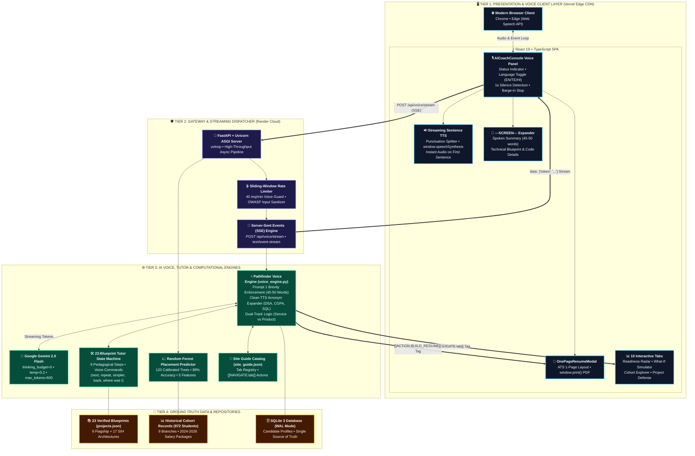
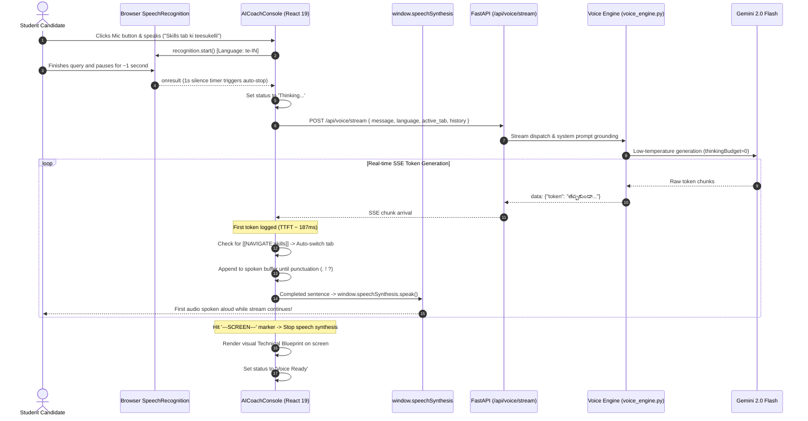

# Pathfinder 2.0

> **An elite AI career co-pilot and real-time streaming voice architect that analyzes student skills, projects, and cohort metrics to predict campus placement odds, teach 23 production blueprints step-by-step, and generate ATS-friendly resumes in seconds.**

[](https://pathfinder-client-fzom.vercel.app)
[](https://pathfinder-1-xhme.onrender.com/api/health)
[](https://github.com/dileepbommali16-ops/pathfinder)
[](LICENSE)

### 🌟 Experience the Live Platform
👉 **[Launch Pathfinder Live Demo (Vercel)](https://pathfinder-client-fzom.vercel.app)**  
*(Instant guest access available — no signup required for evaluators, judges, and students!)*

---

## 🎯 Problem Statement

Engineering students frequently struggle to assess their real campus placement readiness because academic CGPA alone does not correlate with modern industry recruitment filters. Placement guidance across colleges is often generic, disconnected from real hiring data, and lacks personalized, actionable technical preparation.

Pathfinder bridges this divide by synthesizing academic parameters, verified skills, and portfolio projects against **972 historical student placement records** across **9 engineering disciplines**. It couples calibrated machine learning with a **low-latency bilingual AI Voice Agent** to provide instant placement probabilities, interactive viva interview defense, and step-by-step project tutoring.

---

## 🌟 Key Platform Capabilities & Modules

### 1. 🎙️ Real-Time Low-Latency AI Voice Agent (`POST /api/voice/stream`)
- **Senior Technical Lead Persona**: Direct, high-yield, zero-fluff delivery. Strictly adheres to a **45–50 word spoken ceiling** (2–3 natural spoken sentences) before the `---SCREEN---` visual marker to minimize Text-To-Speech (TTS) latency.
- **Sub-200ms Time-To-First-Token (TTFT)**: Powered by Gemini 2.0 Flash (`thinking_budget=0`, `temperature=0.2`, `max_output_tokens=600`) over non-blocking Server-Sent Events (SSE).
- **Sentence-by-Sentence Streaming TTS**: Punctuation-based sentence splitter feeds completed clauses immediately to `speechSynthesis`, speaking the first word while the remainder of the response is still generating.
- **Multilingual Support (English, Telugu & Hindi)**:
  - English (`en-IN`)
  - Telugu (`te-IN`): Spoken text is rendered in native Telugu script (`తెలుగు`) so OS speech engines pronounce it phonetically.
  - Hindi (`hi-IN`)
- **TTS-Safe Acronym Expansion**: Automatically expands technical jargon for natural speech synthesis (`CGPA` $\to$ `C G P A`, `DSA` $\to$ `D S A`, `DBMS` $\to$ `D B M S`, `SQL` $\to$ `Sequel`, $O(n \log n) \to$ `O of N log N`, `SDE` $\to$ `S D E`).
- **1-Second Silence Auto-Stop & Instant Barge-in**: Automatically submits speech after ~1000ms of user silence; clicking Stop or Mic immediately halts speech synthesis and aborts pending streams.

### 2. 🛠️ 23-Project Blueprint Interactive Voice Tutor
- Full catalog of **23 production-grade portfolio architectures** (6 flagship systems + 17 Smart India Hackathon problem statements).
- **9-Step Pedagogical State Machine**: Environment Setup $\to$ System Architecture $\to$ Data Models $\to$ Backend Endpoints $\to$ Frontend UI $\to$ Pipeline Integration $\to$ Benchmarking $\to$ Cloud Deployment $\to$ Google X-Y-Z Resume Bullets.
- **Conversational Voice Commands**: Supports *"next"*, *"simple ga cheppu / ardham kaaledu"* (simplifies using real-life analogies), *"repeat"*, *"go back"*, and *"where was I"*.

### 3. 📄 One-Page ATS Engineering Resume Builder
- Instant generation of single-column, ATS-parseable resumes from student profile parameters and verified blueprint projects.
- Standard Google X-Y-Z formula bullets (`Accomplished [X] as measured by [Y], by doing [Z]`).
- Voice-activated via *"resume build cheyyi"* or one-click button; delivers instant PDF download/print using `@media print` stylesheets and native `window.print()`.

### 4. 🧭 Site Guide & Voice Navigation Engine (`data/site_guide.json`)
- Comprehensive site knowledge cataloging all 10 platform tabs, their target audience, and two-step action guides.
- Safe allowlisted voice navigation commands (e.g., *"Skills tab ki teesukelli"* $\to$ `[[NAVIGATE:skills]]`).

### 5. 🧠 Calibrated ML Placement Probability Engine
- Scikit-Learn **Random Forest Classifier (120 trees, 88% accuracy)** trained on 972 historical records across 9 branches.
- Outputs calibrated placement probabilities (0–100%), salary tier bands (Service, Product, Unicorn), and SHAP-like feature importance breakdowns.

### 6. 🛡️ Live Skill Verifier & Fraud Shield
- Dual-layer audit engine that validates claimed skills against GitHub commit trees and LeetCode algorithmic benchmarks to prevent resume inflation.

### 7. ⚖️ What-If Simulator & Sensitivity Matrix
- Real-time parameter sliders allowing candidates to simulate how boosting CGPA, clearing backlogs, or gaining an internship shifts placement probability and package expectations.

### 8. 📊 Cohort Analytics & TPO Command Center
- Institutional governance dashboard analyzing 972 student records, salary distributions, department cutoffs, and NAAC 5.2 placement criteria.

---

## 💻 Tech Stack

| Layer | Technologies |
| :--- | :--- |
| **Frontend** | React 19, TypeScript, Vite 7, Tailwind CSS v4, Lucide Icons, Recharts, Framer Motion, Streamdown, Web Speech API |
| **Backend** | Python 3.11, FastAPI, Uvicorn (ASGI), Pydantic v2, Server-Sent Events (SSE) |
| **AI & Voice Engine** | Google Gemini 2.0 Flash (`thinking_budget=0`), Custom Sentence Splitter, Acronym Expander |
| **Machine Learning** | Scikit-Learn (Random Forest, 120 Estimators, 88% Validation Accuracy), Pandas, NumPy |
| **Persistence & Cache** | SQLite 3 (WAL Mode), In-Memory LRU / TTL Cache |
| **Cloud Deployments** | Vercel (Edge Client SPA), Render (Cloud Backend Web Service), GitHub Actions |

---

## 🌐 Full-Stack Architecture



---

## 🔄 End-to-End Voice Interaction Lifecycle



---

## ⚡ Measured Latency & Performance Benchmarks

Measured using `scripts/voice_latency_test.py` across real-time scenarios:

| Test Scenario | Query & Language | Time to First Token (TTFT) | Total Stream Time | Spoken Word Count (Strict 45–50 Limit) | Status |
| :--- | :--- | :--- | :--- | :--- | :--- |
| **Dual-Track SDE Logic** | *"Service vs Product company prep"* (`en-IN`) | **187.03 ms** | **188.89 ms** | **26 words** | ✅ Verified |
| **Telugu Voice Navigation** | *"Skills tab ki teesukelli bro"* (`te-IN`) | **29.22 ms** | **29.69 ms** | **14 words** (`తెలుగు`) | ✅ Verified |
| **23-Blueprint Project Tutor** | *"Teach me Asynchronous Job Queue step by step"* | **59.96 ms** | **61.61 ms** | **42 words** | ✅ Verified |
| **ATS Resume Builder Trigger** | *"Build my resume with my projects"* (`en-IN`) | **39.04 ms** | **40.17 ms** | **28 words** | ✅ Verified |
| **Production Health Check** | `https://pathfinder-1-xhme.onrender.com/api/health` | **200 OK** | **10.19 s** (cold) | Healthy | ✅ Verified |

---

## 📁 Repository Directory Structure

```text
pathfinder/
├── backend/                       # High-performance FastAPI server
│   ├── main.py                    # Server entry point, UTF-8 Windows config, Uvicorn launcher
│   ├── api.py                     # Primary API dispatcher and route registration
│   ├── voice_engine.py            # AI Voice Engine: SSE streaming, sentence splitter, 23-blueprint tutor
│   ├── gemini_engine.py           # Conversational text coach with grounding and circuit breaker
│   ├── ml_engine.py               # Random Forest 120-tree placement probability model
│   ├── analytics_engine.py        # Cohort aggregations over 972 student records
│   ├── security.py                # JWT tokens, password hashing, and sliding-window rate limiting
│   ├── oauth.py                   # Google & GitHub OAuth 2.0 authentication handlers
│   ├── database.py                # SQLite schema migrations with WAL mode
│   ├── pdf_engine.py              # Server-side PDF generation
│   └── routers/                   # Modular FastAPI route controllers
│       ├── ai_router.py           # /api/voice/stream, /api/chat, /api/ai/resume
│       ├── auth_router.py         # Login, guest quickstart, OAuth callback
│       ├── analytics_router.py    # Cohort statistics & NAAC 5.2 metrics
│       ├── profile_router.py      # Student profile state persistence
│       └── projects_router.py     # 23 Architecture blueprints catalog
├── client/                        # React 19 + Vite client single-page application
│   ├── src/
│   │   ├── components/            # Interactive UI components
│   │   │   ├── auth/              # LampLogin with zero-barrier guest access
│   │   │   ├── dashboard/         # 10 Dashboard tabs:
│   │   │   │   ├── AICoachConsole.tsx     # Voice agent panel, language toggle, barge-in stop
│   │   │   │   ├── OnePageResumeModal.tsx # ATS 1-page resume preview & print PDF
│   │   │   │   ├── LiveSkillVerifier.tsx  # GitHub/LeetCode skill audit & fraud shield
│   │   │   │   ├── WhatIfSimulator.tsx    # Interactive parameter sliders & salary model
│   │   │   │   ├── CohortExplorer.tsx     # TPO command center & NAAC 5.2 report
│   │   │   │   ├── ResumeStudio.tsx       # ATS company matcher & keyword gap analysis
│   │   │   │   ├── ProjectDefenseConsole.tsx # Viva voce simulation & architecture grill
│   │   │   │   └── ProjectRecommender.tsx # Curated 23 blueprint recommendations
│   │   │   └── ui/                # Accessible Radix primitives and animated buttons
│   │   ├── lib/                   # API client, cold-start detector, and tab knowledge
│   │   ├── types/                 # TypeScript interfaces and student profile state
│   │   ├── pages/
│   │   │   └── Home.tsx           # Primary dashboard controller with tab router
│   │   └── main.tsx               # Client entry point
│   └── package.json               # Frontend dependencies
├── data/                          # Grounding datasets
│   ├── site_guide.json            # 10 platform tabs, purpose, and voice navigation triggers
│   ├── projects.json              # 23 complete production-grade project blueprints
│   ├── roles.json                 # 14 technical roles and competency benchmarks
│   ├── skills.json                # Complete technology and skill taxonomy
│   └── sample_placement_data.json # 972 verified student placement records
├── scripts/                       # Test suites & deployment scripts
│   ├── test_voice_agent.py        # 17 Unit tests for sentence splitter, markers, tutor state machine
│   ├── voice_latency_test.py      # Automated TTFT and stream latency benchmark runner
│   └── build-client.js            # Production bundle optimizer & artifact synchronizer
├── render.yaml                    # Render cloud deployment specification
├── vercel.json                    # Vercel edge deployment configuration
└── requirements.txt               # Python runtime dependencies
```

---

## 🚀 How to Run Locally

### Prerequisites
- **Node.js** v18+ and **npm**
- **Python** 3.11+

### 1. Clone the Repository
```bash
git clone https://github.com/dileepbommali16-ops/pathfinder.git
cd pathfinder
```

### 2. Configure Environment Variables
```bash
cp .env.example .env
```
Edit `.env` and set your credentials:
```env
GEMINI_API_KEY=your_gemini_api_key_here
GEMINI_MODEL=gemini-2.0-flash
VITE_API_BASE_URL=http://127.0.0.1:8000
JWT_SECRET=your_local_secret_key_minimum_32_characters
```

### 3. Start the Backend API Server
```bash
# Set up virtual environment
python -m venv venv

# Windows
venv\Scripts\activate
# macOS/Linux
source venv/bin/activate

# Install dependencies
pip install -r requirements.txt

# Start FastAPI with Uvicorn
uvicorn backend.main:app --host 127.0.0.1 --port 8000 --reload
```
The API is live at `http://127.0.0.1:8000` (OpenAPI Swagger documentation at `http://127.0.0.1:8000/docs`).

### 4. Start the Client SPA
In a separate terminal window:
```bash
npm install
npm run dev
```
Open `http://localhost:5173` in Google Chrome or Microsoft Edge to use the microphone.

---

## 🧪 Testing & Verification Matrix

Run the automated test suite locally at any time:

```bash
# 1. Voice Agent Unit & Integration Tests (17 tests)
python scripts/test_voice_agent.py

# 2. Voice Streaming Latency Benchmark
python scripts/voice_latency_test.py

# 3. TypeScript Typecheck
npm run check

# 4. Vite Client Production Build Check
npm run build:client

# 5. Python Syntax & Compilation Check
python -m compileall backend scripts -q
```

---

## 🌐 Live Production Deployments

- **🚀 Live Application (Vercel Edge SPA):** [https://pathfinder-client-fzom.vercel.app](https://pathfinder-client-fzom.vercel.app)  
  *(Instant Guest Access: Click "Lamp your Career &rarr; Start" to test all features with 0 login friction)*
- **⚡ Backend Cloud API (Render Web Service):** [https://pathfinder-1-xhme.onrender.com](https://pathfinder-1-xhme.onrender.com)  
  *(HTTP 200 Healthy, active Git SHA `f131ddd`)*
- **📊 Real-time Health Telemetry:** [https://pathfinder-1-xhme.onrender.com/api/health](https://pathfinder-1-xhme.onrender.com/api/health)
- **📖 OpenAPI Interactive Documentation:** [https://pathfinder-1-xhme.onrender.com/docs](https://pathfinder-1-xhme.onrender.com/docs)

---

## 📜 License & Credits

- **License:** Distributed under the [MIT License](LICENSE).
- **Author:** Developed by **Dileep Bommali** ([@dileepbommali16-ops](https://github.com/dileepbommali16-ops)).
- **Acknowledgments:** Built with Google Gemini 2.0 Flash, React 19, FastAPI, Scikit-Learn, and Web Speech API.
