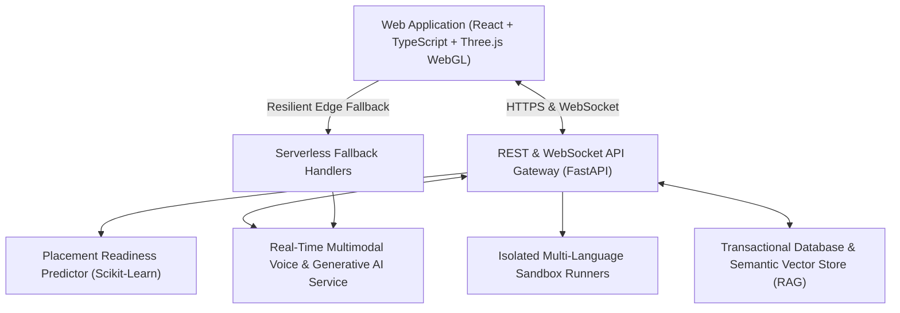

# Pathfinder 2.0 — AI-Powered Campus Placement & Career Readiness Platform

Pathfinder 2.0 is a full-stack career readiness and technical interview preparation platform for engineering students. It unifies predictive placement analytics, resume tailoring, multi-language code execution, system architecture blueprints, and a real-time 3D voice mentor in one web workspace.

**Live Website:** [https://pathfinder-client-fzom.vercel.app](https://pathfinder-client-fzom.vercel.app)

---

## Problem Statement

Engineering students preparing for campus recruitment face four persistent gaps:

1. **ATS Resume Drop-Offs:** Strong candidates get rejected before interviews because resumes lack quantified impact statements, target role alignment, and single-column ATS formatting.
2. **Surface-Level Portfolio Projects:** Generic tutorial clones fail when hiring panels test distributed workflows, failure handling, caching, and system design trade-offs.
3. **Lack of Objective Benchmarking:** Students apply across companies without data-backed visibility into how their CGPA, backlogs, coding proficiency, and internship history affect shortlist probability.
4. **Disconnected Practice Workflows:** Coding editors, technical viva practice, project guides, and placement tracking live across separate tools, slowing down structured preparation.

---

## Solution Overview

Pathfinder 2.0 solves these bottlenecks through six integrated workspaces:

| Workspace | Core Capability | Student Outcome |
| :--- | :--- | :--- |
| **1. Readiness Dashboard & Simulator** | Interactive ML placement probability card, 6-axis readiness breakdown, company radar benchmarks, and real-time What-If trajectory sliders. | Understand exact placement odds and test how closing gaps boosts shortlist chances. |
| **2. 1-Click JD Tailor & ATS Studio** | Compares a student profile and resume against company job descriptions, highlights missing skills/keywords, and builds a 1-page printable ATS PDF. | Submit role-aligned, quantified resumes engineered to pass recruiter screening. |
| **3. Live Coding & Technical Viva Arena** | Browser-based 11-language compiler (`Python`, `C`, `C++`, `Java`, `JavaScript`, `TypeScript`, `SQL`, `Rust`, `Go`, `C#`, `PHP`) paired with company-style mock interviews and STAR project defense grading. | Practice writing compilable code and defending algorithmic complexity aloud. |
| **4. 28 Engineering Project Blueprints** | Curated system design architectures across CS, AI/ML, Cloud, Data, and Embedded tracks with domain filters and implementation guides. | Replace weak starter apps with interview-ready production architectures. |
| **5. Cohort Intelligence & 6-Week Roadmap** | Historical branch/skill placement distributions across 972 campus records paired with a personalized 6-week preparation sprint plan. | Benchmark against placed peers and execute a focused weekly study schedule. |
| **6. DAS — 3D Voice Career Assistant** | Interactive WebGL 3D holographic agent supporting real-time voice and text interaction, concept explanations, coding studio automation, and hands-free slide control. | Receive instant technical mentoring and control platform workflows seamlessly. |

---

## High-Level System Architecture



---

## Technology Stack

| Layer | Technologies |
| :--- | :--- |
| **Frontend** | React 19, TypeScript, Vite, Tailwind CSS, React Router, Three.js / React Three Fiber, Recharts, Web Audio API |
| **Backend** | Python 3.11, FastAPI, Uvicorn (ASGI & WebSockets), Pydantic v2, HTTPX |
| **AI & Machine Learning** | Supervised Random Forest Pipeline (Scikit-Learn), Real-Time Multimodal Voice & Generative AI, Semantic Vector Retrieval (RAG), Automated PDF Parsing & Generation |
| **Sandboxed Execution** | Hardened In-Memory SQL Sandbox & Isolated Remote Compiler Runtimes across 11 Languages |
| **Data & Infrastructure** | PostgreSQL with Vector Indexing, SQLite (WAL Mode), Cloud Web & API Hosting, Automated CI Workflows |

---

## Project Overview

```text
pathfinder-main/
├── client/        # React + TypeScript frontend SPA, 3D voice interface, and studio modules
├── backend/       # FastAPI routers, ML predictor, code execution dispatcher, and AI services
├── api/           # Serverless edge fallback handlers
├── data/          # Calibrated placement benchmark dataset and engineering catalogs
├── supabase/      # Vector database schema and RPC migrations
└── .github/       # Automated CI test and repository workflows
```

---

## Local Development & Verification

### 1. Start the Backend Server

```bash
python -m venv .venv
# Windows: .venv\Scripts\activate  |  macOS/Linux: source .venv/bin/activate
pip install -r requirements.txt
# Configure local environment variables using .env.example before starting
uvicorn backend.api:app --host 0.0.0.0 --port 8000 --ws auto
```

### 2. Start the Frontend Client

```bash
pnpm install
pnpm dev
```

### 3. Automated Quality Checks

```bash
# Backend unit & integration tests
python -m pytest -q

# Frontend unit tests & static checks
npx vitest run
npx tsc --noEmit
pnpm run build:vercel
```

---

## License

Released under the [MIT License](LICENSE).
