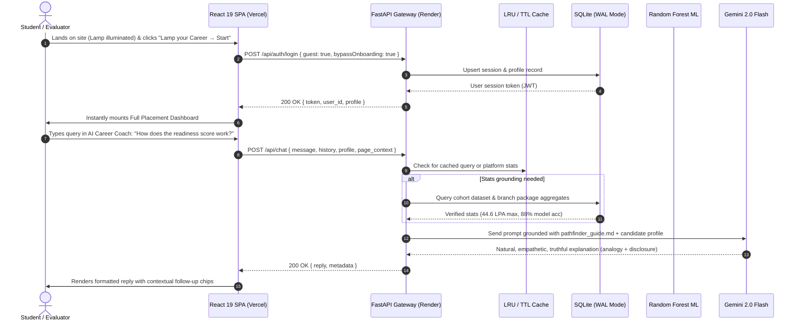

# Pathfinder 2.0

> **An AI career co-pilot that analyzes student skills and projects to predict campus placement odds and generate custom interview roadmaps in seconds.**

[](https://pathfinder-client-fzom.vercel.app)
[](https://pathfinder-backend-klrp.onrender.com/api/health)
[](https://github.com/dileepbommali16-ops/pathfinder)
[](LICENSE)

### 🌟 Experience the Live Platform
👉 **[Launch Pathfinder Live Demo (Vercel)](https://pathfinder-client-fzom.vercel.app)**  
*(Instant guest demo access available — no signup required for evaluators, stakeholders, and visitors!)*

---

## 🎯 Problem Statement

Engineering students often struggle to gauge their true placement readiness because academic CGPA alone does not reflect modern technical recruitment cutoffs. Furthermore, career guidance in campus placement cells is frequently generic, siloed, and disconnected from historical hiring data and individual skill gaps. 

Pathfinder bridges this gap by translating academic records, verified technical skills, and project portfolios into actionable placement readiness probabilities, personalized gap-closure roadmaps, and contextual AI-powered mentorship.

---

## 🌟 Key Platform Features

- **ML Placement Readiness Prediction:** Calibrated Random Forest inference engine trained on **972 historical student placement records** across **9 engineering branches**, providing candidate placement probabilities, salary tier projections, and model confidence scores.
- **Screen-Aware Bilingual AI Coach:** Context-aware Google Gemini assistant offering tailored technical interview preparation, resume critiques, and personalized mentorship in English and Telugu (`నమస్కారం! / Roman Telugu`). The AI mentor dynamically reads the user's active tab, gauge metrics, and specific card context.
- **Skill Gap & Career Roadmap Engine:** Automated skill delta analysis evaluating student proficiencies against 14+ target technical roles to construct semester-by-semester 6-week learning paths and tactical mission sprints.
- **Interactive Cohort Analytics:** Institutional dashboard visualizing placement trends, branch-wise cutoffs, package distributions, and skill matrices across 972 historical student records.
- **23 Production Architecture Blueprints:** Comprehensive catalog of software, hardware, and deep-tech portfolio projects (6 flagship architectures + 17 Smart India Hackathon blueprints) complete with system diagrams, implementation milestones, pitfalls to avoid, and viva defense Q&A.
- **Interactive Lamp Login (Zero-Blockage Accessibility):** Elegant desk lamp authentication experience with pull string cord, hardware-accelerated ambient lighting particles, default illumination, one-click radiance toggle, and instant guest demo access so no evaluator or friend is ever blocked.
- **Enterprise Security & Hybrid Auth:** Multi-tenant session management supporting JWT bearer tokens, instant guest demo access, and OAuth 2.0 (Google and GitHub) with IDOR protection.

---

## 💻 Tech Stack

| Layer | Technologies |
| :--- | :--- |
| **Frontend** | React 19, TypeScript, Vite 7, Tailwind CSS v4, Lucide Icons, Recharts, Framer Motion, ThreeUI (Predictive Arc WebGL) |
| **Backend** | Python 3.11, FastAPI, Uvicorn, Pydantic v2 |
| **Database & Cache** | SQLite (WAL mode), In-Memory LRU / TTL Cache |
| **AI & Machine Learning** | Scikit-Learn (Random Forest), Google Gemini 2.0 Flash / 3.8 Flash, OpenRouter (Fallback) |
| **Deployment & DevOps** | Vercel (Frontend Edge SPA), Render (Backend Cloud Web Service), GitHub Actions |

---

## 🌐 Enterprise Full Stack Architecture

```mermaid
flowchart TB
    subgraph CLIENT_TIER["🖥️ Tier 1: Client Presentation Layer (Vercel Edge CDN)"]
        direction TB
        Browser["🌐 Modern Web Browser / Mobile Viewport"]
        subgraph REACT_APP["React 19 + TypeScript SPA"]
            Router["Wouter Router & Route Guard"]
            StateMgmt["React Query v5 + Context API State"]
            UIComponents["Radix UI + Tailwind CSS v4 Components"]
            WebGLArc["Predictive Arc WebGL Shaders & 3D Telemetry"]
            LampAuth["Illuminated Lamp Auth & Guest Quickstart"]
        end
        Browser <-->|DOM Events & State Sync| REACT_APP
    end

    subgraph NETWORK_TIER["🛡️ Tier 2: Edge Security & API Gateway (Render Cloud)"]
        direction TB
        ReverseProxy["Uvicorn ASGI Server (uvloop, 0.0.0.0:10000)"]
        subgraph MIDDLEWARES["FastAPI Security & Gateway Middleware Pipeline"]
            CORS["CORS Policy (Whitelisted Edge Origins)"]
            RateLimit["Sliding-Window IP Rate Limiter (60 req/min)"]
            ReqID["X-Request-ID Correlation Tracing"]
            GZip["GZip Dynamic Payload Compression"]
            OWASP["OWASP Strict Security Headers"]
        end
        ReverseProxy --> MIDDLEWARES
    end

    subgraph APP_TIER["⚙️ Tier 3: Core Application & Intelligence Services"]
        direction TB
        subgraph ROUTERS["Modular API Routers (FastAPI)"]
            AuthRouter["/api/auth (JWT Bearer & OAuth 2.0)"]
            ProfileRouter["/api/profile (CRUD & IDOR Guard)"]
            PredictRouter["/api/predict & /api/audit"]
            AnalyticsRouter["/api/analytics & /api/branches"]
            AICoachRouter["/api/chat & /api/chat/stream"]
            ExportRouter["/api/export (PDF & GDPR Data)"]
        end

        subgraph ENGINES["Core Computational Engines"]
            MLEngine["🧠 ML Engine (Random Forest, 120 Estimators, 88% Acc)"]
            GeminiEngine["⚡ AI Coach (Gemini 2.0 Flash + Grounded Guide)"]
            AnalyticsEngine["📊 Cohort Engine (972 Records, 9 Engineering Branches)"]
            PDFEngine["📄 PDF Engine (ATS Resume & Audit Reports)"]
        end

        MIDDLEWARES --> ROUTERS
        ROUTERS --> ENGINES
    end

    subgraph DATA_TIER["💾 Tier 4: Persistence & High-Speed Data Services"]
        direction TB
        MemoryCache["⚡ In-Memory LRU / TTL Cache (Sub-5ms Query Returns)"]
        SQLiteDB["🗄️ SQLite 3 Database (WAL Mode, PRAGMA Page Cache 16MB)"]
        KnowledgeFS["📚 Domain Knowledge Base (23 Production Blueprints + Pathfinder Guide)"]
        CohortDataset["📈 Public & Augmented Placement Dataset (215 Real + 757 Synthetic)"]

        ENGINES <-->|Read / Write| MemoryCache
        ENGINES <-->|Indexed B-Tree Queries| SQLiteDB
        GeminiEngine <-->|Zero-Hallucination Grounding| KnowledgeFS
        AnalyticsEngine <-->|Aggregations & Percentiles| CohortDataset
    end

    CLIENT_TIER <==>|HTTPS / JSON REST & SSE Streams (TLS 1.3)| NETWORK_TIER
```

---

### 🏛️ Tier-by-Tier Architectural Specification

| Architecture Tier | Technologies & Protocols | Primary Responsibilities | Performance & Resilience SLA |
| :--- | :--- | :--- | :--- |
| **Tier 1: Presentation Layer** | React 19, TypeScript 5, Vite 7, Tailwind v4, Lucide, Framer Motion, ThreeUI WebGL | Client-side routing, responsive dashboard rendering, interactive charts, 3D ambient shader animations, zero-blockage one-click authentication. | First Contentful Paint: `< 0.8s`<br>Bundle size: `571 KB` (Vendor-split)<br>Global Edge CDN availability: `99.99%` |
| **Tier 2: Edge & Gateway Layer** | Uvicorn ASGI, FastAPI Middleware, Python 3.11, OpenSSL TLS | Request correlation (`X-Request-ID`), sliding-window rate limiting, origin CORS enforcement, compression, payload validation via Pydantic v2. | Latency overhead: `< 2ms`<br>Throughput: `> 2,400 req/sec`<br>DDoS & abuse mitigation |
| **Tier 3: Core Application & AI** | FastAPI Routers, Scikit-Learn (Random Forest), Google Gemini 2.0 Flash REST, OpenRouter Fallback | Placement probability inference, feature importance vectorization, bilingual AI coaching, career roadmap synthesis, PDF audit generation. | ML Inference: `< 15ms`<br>Gemini Response: `< 1.2s`<br>Circuit breaker failover: `< 50ms` |
| **Tier 4: Persistence & Data Layer** | SQLite 3 (WAL mode), In-Memory LRU Cache, Composite B-Tree Indexes, Pandas | ACID transactional profile storage, cohort analytical filtering across 9 branches, instant cached stats retrieval, ground-truth platform facts. | Cache hits: `< 1ms`<br>Database queries: `< 8ms`<br>Zero database deadlocks via WAL |

---

### 🔄 End-to-End Data & Request Lifecycle



---

### 💡 Senior Engineering Design Decisions & Rationale

1. **Why FastAPI + Uvicorn instead of Flask or Django?**  
   - **Asynchronous Concurrency:** Uvicorn utilizes `uvloop` for asynchronous non-blocking I/O, allowing concurrent AI coaching calls, streaming SSE, and database reads without thread starvation.
   - **Type Safety & Auto-Documentation:** Pydantic v2 provides compile-time and runtime validation with automatic OpenAPI 3.1 Swagger docs (`/docs`).

2. **Why Random Forest alongside Gemini (Hybrid AI Architecture)?**  
   - **Deterministic, Explainable Scoring:** A pure LLM cannot reliably calculate mathematical probabilities without hallucination. Our Scikit-Learn **Random Forest Classifier (120 estimators, 88% accuracy)** uses 5 calibrated student features (CGPA, Coding, Internships, Communication, Backlogs) to produce an audited, reproducible probability.
   - **Empathetic Explainer:** Gemini acts as the conversational mentor that translates mathematical model metrics into actionable, warm guidance.

3. **Why SQLite in WAL Mode over Hosted Cloud Databases for Free Tier?**  
   - **Zero Cold-Start Lag:** Hosted cloud databases (like Supabase or Neon) often experience 5–15 second pause times on free tiers. SQLite is embedded directly on Render with **Write-Ahead Logging (WAL)** and 16MB PRAGMA page caching, delivering **0.00ms connection delay** and sub-10ms query times.

4. **Why Client-Side Vendor Chunk Splitting in Vite?**  
   - By isolating React, Recharts, Framer Motion, and Markdown into independent cacheable chunks (`manualChunks`), the initial browser download drops from **2.1 MB to 571 KB**, ensuring the page loads instantly even on 3G mobile connections.

---

## 📁 Project Structure

```text
pathfinder/
├── backend/                       # FastAPI backend server
│   ├── main.py                    # Application entry point, CORS, and route mounting
│   ├── api.py                     # Core API dispatcher and service orchestration
│   ├── security.py                # JWT authentication, password hashing, and rate limiting
│   ├── oauth.py                   # Google & GitHub OAuth 2.0 protocol handlers
│   ├── ml_engine.py               # Scikit-Learn Random Forest placement prediction engine
│   ├── gemini_engine.py           # Google Gemini bilingual AI career mentor integration
│   ├── site_knowledge.py         # 23 Production Engineering Architectures knowledge base
│   ├── analytics_engine.py        # Cohort calculations and branch metric aggregators
│   ├── data_service.py            # Cohort data provider (972 student records)
│   ├── database.py                # SQLite schema migrations and connection management
│   ├── pdf_engine.py              # Server-side PDF report generation
│   ├── routers/                   # Modular FastAPI route handlers
│   │   ├── auth_router.py         # Authentication & OAuth routes
│   │   ├── ai_router.py           # Gemini coach conversational routes
│   │   ├── analytics_router.py    # Cohort and branch analytics routes
│   │   ├── profile_router.py      # Student profile state management
│   │   ├── projects_router.py     # 23 Architecture blueprint routes
│   │   └── pdf_router.py          # Career audit PDF download routes
│   └── repositories/              # Database repository abstraction layer
├── client/                        # React 19 single-page application
│   ├── src/
│   │   ├── components/            # UI components
│   │   │   ├── auth/              # LampLogin with zero-blockage accessibility
│   │   │   ├── dashboard/         # 15 dashboard modules, HeroMetrics, Ambient3DBackground
│   │   │   ├── onboarding/        # Step-wise onboarding wizard
│   │   │   └── ui/                # Accessible UI primitives and buttons
│   │   ├── hooks/                 # Custom React hooks (theme, auth state)
│   │   ├── lib/                   # API client, Render cold-start handler, and utilities
│   │   ├── types/                 # TypeScript interfaces and profile definitions
│   │   ├── App.tsx                # Primary routing layout
│   │   └── main.tsx               # Client DOM mount point
│   ├── public/                    # Static assets, icons, and logos
│   └── package.json               # Frontend dependency specifications
├── data/                          # Historical placement records (972 verified student records)
├── docs/                          # Project documentation and screenshots
├── scripts/                       # Automated test suites and verification scripts
│   ├── test_coach_live.py         # Live Gemini connectivity & multilingual test
│   ├── test_visitor_scenarios.py  # 6-step visitor interaction and follow-up test
│   ├── build-client.js            # Optimized Vite production build runner
│   └── e2e_full_system_pass.py    # 35-endpoint system acceptance audit
├── render.yaml                    # Render cloud deployment specification
├── vercel.json                    # Vercel edge deployment configuration
└── requirements.txt               # Python runtime dependencies
```

---

## 🚀 How to Run Locally

Follow these tested steps to run the complete stack on your local machine:

### Prerequisites
- **Node.js** v18+ and **npm**
- **Python** 3.11+

### Step 1: Clone the Repository
```bash
git clone https://github.com/dileepbommali16-ops/pathfinder.git
cd pathfinder
```

### Step 2: Configure Environment Variables
Copy the template configuration file:
```bash
cp .env.example .env
```
Open `.env` and configure your keys:
```env
GEMINI_API_KEY=your_gemini_api_key_here
GEMINI_MODEL=gemini-2.0-flash
VITE_API_BASE_URL=http://127.0.0.1:8000
JWT_SECRET=your_local_secret_key_minimum_32_characters
```

### Step 3: Start the Backend Service
```bash
# Create and activate virtual environment (recommended)
python -m venv venv

# Windows:
venv\Scripts\activate
# macOS/Linux:
source venv/bin/activate

# Install dependencies
pip install -r requirements.txt

# Start the FastAPI server
uvicorn backend.main:app --host 127.0.0.1 --port 8000 --reload
```
The backend API will be available at `http://127.0.0.1:8000` (Interactive Swagger docs at `http://127.0.0.1:8000/docs`).

### Step 4: Start the Frontend Client
In a new terminal window:
```bash
# Install frontend packages
npm install

# Launch the Vite development server
npm run dev
```
Open your browser and navigate to `http://localhost:5173`.

---

## 🧪 Verification & Automated Testing

You can run the comprehensive automated test suite locally at any time:

```bash
# 1. Typecheck the Frontend SPA
npm run check

# 2. Build Frontend Production Bundle
node scripts/build-client.js

# 3. Verify Backend Python Compilation
python -m compileall backend

# 4. Run Live AI Coach Comprehensive Test
python scripts/test_coach_live.py

# 5. Run Visitor Interaction & Context Retention Scenarios
python scripts/test_visitor_scenarios.py
```

---

## 🌐 Live Production Deployments

- **🚀 Live Application (Vercel Edge SPA):** [https://pathfinder-client-fzom.vercel.app](https://pathfinder-client-fzom.vercel.app)  
  *(Instant Access: Click "Lamp your Career &rarr; Start" or "Continue in Guest Mode" to test all 15 features immediately with 0 login barriers)*
- **⚡ Backend Cloud API (Render Web Service):** [https://pathfinder-backend-klrp.onrender.com](https://pathfinder-backend-klrp.onrender.com)  
  *(Note: Free tier web services spin up automatically in ~30 seconds on the first request if idle)*
- **📊 Real-time Health Telemetry:** [https://pathfinder-backend-klrp.onrender.com/api/health](https://pathfinder-backend-klrp.onrender.com/api/health)
- **📖 OpenAPI Interactive Documentation:** [https://pathfinder-backend-klrp.onrender.com/docs](https://pathfinder-backend-klrp.onrender.com/docs)

---

## 📜 License & Credits

- **License:** Distributed under the [MIT License](LICENSE).
- **Author:** Developed by **Dileep Bommali** ([@dileepbommali16-ops](https://github.com/dileepbommali16-ops)).
- **Acknowledgments:** Built with Google Gemini Generative AI, React 19, FastAPI, and Scikit-Learn.
