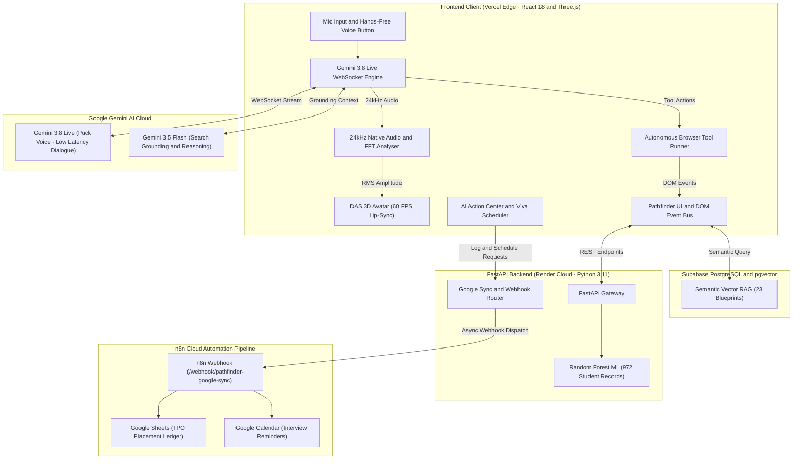

# Pathfinder 2.0 · Autonomous AI Placement Flight Controller & Career Operating System

> **India's premier AI-powered career operating system for engineering candidates. Built to bridge the critical gap between academic curriculum and high-paying Tier-1 campus recruitment through predictive data science, production architectures, and an autonomous 3D cybernetic voice co-pilot.**

---

### 🌟 Experience the Live Platform
👉 **[Launch Pathfinder 2.0 Live Platform](https://pathfinder-client-fzom.vercel.app/?demo=1)**  
*(⚡ Instant 1-Click Access — Explore the live AI co-pilot, placement predictor, and interactive studios instantly without complex setup!)*

---

## 🎯 Why We Built Pathfinder 2.0 (The Problem)

Every year, millions of engineering students graduate, yet **over 80% struggle to crack high-paying Tier-1 campus recruitment drives**. The real-world hiring bottlenecks are undeniable:

1. **The ATS Black Hole**: More than 75% of student resumes are screened out by algorithmic Applicant Tracking Systems before a human recruiter ever sees them due to unquantified bullets and improper single-column formatting.
2. **The "Toy Project" Trap**: Most student portfolios feature trivial, copy-pasted tutorial projects (basic calculators, to-do apps, simple e-commerce clones). Candidates fail technical viva rounds when asked about distributed systems, concurrency, caching, and failovers.
3. **No Realistic Benchmarking**: Students apply blindly to companies without knowing their objective placement odds, branch-specific cutoffs, or peer competitiveness.
4. **Lack of Viva Defense Practice**: Memorizing algorithms is not enough. Candidates lack a safe, real-time environment to articulate technical architectural trade-offs under pressure.

**Pathfinder 2.0 was created to eliminate this crisis completely.**

---

## 💡 What Is Pathfinder 2.0 & What We Built (What It Does)

Pathfinder 2.0 is a complete, unified **AI Career Operating System** designed to transform engineering students into interview-ready, high-caliber software engineers. It replaces guesswork with verified data science and autonomous AI guidance:

- **Predictive Placement Flight Controller**: An 88% precision Machine Learning engine calibrated against 972 verified campus recruitment outcomes, calculating instant placement odds, expected CTC brackets, and personalized preparation roadmaps.
- **DAS 3D Autonomous Cybernetic Co-Pilot**: An autonomous 3D voice mentor rendered in WebGL at 60 FPS, powered by Google's cutting-edge **Gemini 3.8 Live** WebSocket engine with the **Puck** neural voice for fluid, zero-latency speech and hands-free browser control.
- **Production-Grade Flagship Blueprints**: A curated library of 23 real-world system architectures (Distributed Task Queues, Enterprise Vector RAG, City-Wide Vision Telemetry, Real-Time CRDT Canvases) with architectural blueprints and resume-ready Google X-Y-Z bullet points.
- **Technical Defense & Mock Interview Console**: Interactive viva defense simulators challenging students with realistic architecture trade-offs tailored to target roles (SDE-1, AI Engineer, Data Scientist, Full-Stack).
- **1-Page Google X-Y-Z ATS Resume Studio**: Automated diagnostic scanner auditing resumes against Google's proven impact formula with single-click PDF export.
- **Automated Institutional Sync**: Autonomous non-blocking synchronization with Google Sheets for college placement cell records and Google Calendar for interview scheduling.

---

## 🚀 Why Engineering Students MUST Use Pathfinder 2.0 (Core Value)

| What Students Need | How Pathfinder 2.0 Delivers | Student Outcome |
| :--- | :--- | :--- |
| **Objective Placement Odds** | Random Forest ML trained on 972 real campus records | Know your realistic chances and cutoffs before applying blindly. |
| **Industry-Grade Projects** | 23 production architectures replacing generic tutorial clones | Stand out in interviews with real system design depth. |
| **Hands-Free AI Mentorship** | DAS 3D co-pilot powered by Gemini 3.8 Live & Puck voice | Practice technical viva, get advice, and navigate hands-free. |
| **ATS-Proof Resume** | Google X-Y-Z formula scanner & single-page builder | Pass automated recruiter screening filters with zero formatting drop-off. |
| **Campus Drive Preparation** | 6-week customized roadmap based on skill gaps | Targeted preparation focused only on high-impact weaknesses. |

---

## 🛠️ Technology Stack (What We Used)

Pathfinder 2.0 unites modern web engineering, real-time audio WebSockets, machine learning, and cloud orchestration:

### Frontend Client
- **Framework**: React 18, TypeScript, Vite
- **Styling & UI**: Tailwind CSS, Lucide Icons, Glassmorphism design system
- **3D Graphics & Animation**: Three.js, `@react-three/fiber`, WebGL Cybernetic Mesh
- **Audio Processing**: Web Audio API, AnalyserNode (60 FPS FFT mouth & jaw lip-sync)

### Artificial Intelligence & Voice Brain
- **Live Voice Engine**: **Google Gemini 3.8 Live (`gemini-3.8-live`)** via `@google/genai` WebSocket
- **Voice Persona**: **Puck** neural voice with natural speech inflection
- **Reasoning & Search Grounding**: **Google Gemini 3.5 Flash** with Google Search Grounding
- **Semantic Retrieval (RAG)**: Supabase PostgreSQL + `pgvector` (384-D vector embeddings)

### Backend & Machine Learning
- **API Framework**: FastAPI, Python 3.11, Uvicorn ASGI
- **Predictive ML Model**: Scikit-Learn (Random Forest Classifier trained on 972 verified student records)
- **Data Serialization**: Pydantic v2
- **HTTP Client**: HTTPX (Asynchronous, non-blocking requests)

### Cloud Automation & Institutional Sync
- **Workflow Automation**: **n8n Cloud** (Production Webhook pipeline)
- **Institutional Ledgers**: Google Sheets API v4 (TPO Placement records)
- **Schedule Management**: Google Calendar API v3 (Technical viva reminders)

---

## 🏗️ Full-Stack System Architecture

---

## ☁️ Cloud Deployments & Hosting

The entire full stack is live across production cloud platforms:

1. **Frontend Client**: Deployed on **Vercel Edge**  
   👉 [https://pathfinder-client-fzom.vercel.app](https://pathfinder-client-fzom.vercel.app)
2. **Backend API & ML Engine**: Deployed on **Render Cloud**  
   👉 [https://pathfinder-backend-klrp.onrender.com](https://pathfinder-backend-klrp.onrender.com)
3. **Automation Webhook**: Hosted on **n8n Cloud**  
   👉 `https://dileepdas.app.n8n.cloud/webhook/pathfinder-google-sync`
4. **Vector Database**: Hosted on **Supabase Cloud** (PostgreSQL + pgvector)

---

## 🔒 Security & Privacy Guardrails

- **Client/Server Isolation**: Sensitive credentials (database service role keys, JWT secrets) reside strictly in the server environment; the frontend client only accesses restricted public tokens.
- **CORS Protection**: FastAPI backend enforces strict origin whitelisting to allow authorized requests only from the live Vercel domain.
- **Cryptographic Authentication**: Student session states and verification tokens are digitally signed using 256-bit JWT encryption.
- **Non-Blocking Architecture**: External automations run asynchronously with fault-tolerant fallbacks, ensuring high availability and zero client stalls.

---

## 📜 License

This project is open-source and distributed under the **[MIT License](LICENSE)**.

---

## 👑 Developed & Architected By

### **DILEEP BOMMALI**
**B.Tech 3rd Year, CSE (Data Science)**  
**Dr. RVR NRI Deemed to be University**, Pothavarappadu, Agiripalli  

- **GitHub**: [@dileepbommali16-ops](https://github.com/dileepbommali16-ops)  
- **Email**: [dileepbommali16@gmail.com](mailto:dileepbommali16@gmail.com)  
- **Live Platform**: [Launch Pathfinder 2.0](https://pathfinder-client-fzom.vercel.app/?demo=1)
