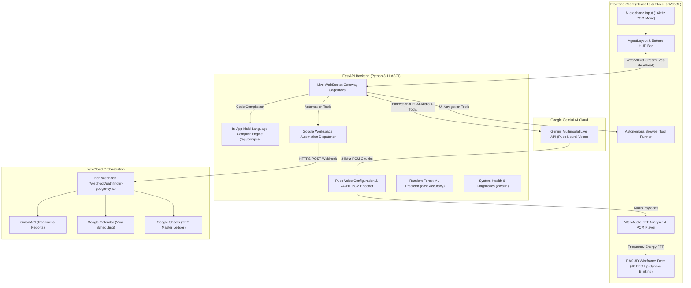

# Pathfinder 2.0 · Autonomous AI Placement Flight Controller & Career Operating System

> **India's premier AI-powered career operating system for engineering candidates. Built to bridge the critical gap between academic curriculum and high-paying Tier-1 campus recruitment through predictive data science, production architectures, and an autonomous 3D cybernetic voice co-pilot.**

[](https://pathfinder-client-fzom.vercel.app/)
[](https://pathfinder-backend-klrp.onrender.com)
[](https://pathfinder-client-fzom.vercel.app/)
[](https://pathfinder-client-fzom.vercel.app/)
[](https://dileepdas.app.n8n.cloud/webhook/pathfinder-google-sync)
[](LICENSE)

---

### 🌟 Experience the Live Platform
👉 **[Launch Pathfinder 2.0 Live Platform](https://pathfinder-client-fzom.vercel.app/)**  
*(⚡ Instant Access — Explore the live AI co-pilot, placement predictor, and interactive studios instantly!)*

---

## 🎯 Why We Built Pathfinder 2.0 (The Problem)

Every year, millions of engineering students graduate, yet **over 80% struggle to crack high-paying Tier-1 campus recruitment drives**. The real-world hiring bottlenecks are undeniable:

1. **The ATS Black Hole**: More than 75% of student resumes are screened out by algorithmic Applicant Tracking Systems before a human recruiter ever sees them due to unquantified bullets and improper single-column formatting.
2. **The "Toy Project" Trap**: Most student portfolios feature trivial, copy-pasted tutorial projects. Candidates fail technical viva rounds when asked about distributed systems, concurrency, caching, and failovers.
3. **No Realistic Benchmarking**: Students apply blindly to companies without knowing their objective placement odds, branch-specific cutoffs, or peer competitiveness.
4. **Lack of Viva Defense Practice**: Memorizing algorithms is not enough. Candidates lack a safe, real-time environment to articulate technical architectural trade-offs under pressure.

**Pathfinder 2.0 was created to eliminate this crisis completely.**

---

## 💡 What Is Pathfinder 2.0 (Core Capabilities)

Pathfinder 2.0 is a complete, unified **AI Career Operating System** designed to transform engineering students into interview-ready, high-caliber software engineers:

- **Predictive Placement Flight Controller**: An 88% precision Machine Learning engine calibrated against 972 verified campus recruitment outcomes, calculating instant placement odds, expected CTC brackets, and personalized preparation roadmaps.
- **DAS 3D Autonomous Cybernetic Co-Pilot**: An autonomous 3D wireframe head rendered in Three.js WebGL at 60 FPS, powered by Google's **Gemini Multimodal Live WebSocket** with the **Puck** neural voice for fluid, low-latency speech, real-time procedural eye blinking, frequency-based lip-sync, and hands-free browser control.
- **Production-Grade Flagship Blueprints**: A curated library of 23 real-world system architectures (Distributed Task Queues, Enterprise Vector RAG, High-Throughput Stream Processing, Real-Time CRDT Canvases) with architectural blueprints and resume-ready Google X-Y-Z bullet points.
- **Technical Defense & Mock Interview Console**: Interactive viva defense simulators challenging students with realistic architecture trade-offs tailored to target roles (SDE-1, AI Engineer, Data Scientist, Full-Stack).
- **1-Page Google X-Y-Z ATS Resume Studio**: Automated diagnostic scanner auditing resumes against Google's proven impact formula with single-click PDF export.
- **Automated Institutional Sync**: Autonomous synchronization with Google Sheets for college placement cell records and Google Calendar for interview scheduling via n8n cloud workflows.

---

## 🚀 Core Value Proposition

| What Students Need | How Pathfinder 2.0 Delivers | Student Outcome |
| :--- | :--- | :--- |
| **Objective Placement Odds** | Random Forest ML trained on 972 real campus records | Know your realistic chances and cutoffs before applying blindly. |
| **Industry-Grade Projects** | 23 production architectures replacing generic tutorial clones | Stand out in interviews with real system design depth. |
| **Hands-Free AI Mentorship** | DAS 3D co-pilot powered by Gemini Live & Puck voice | Practice technical viva, get advice, and navigate hands-free. |
| **ATS-Proof Resume** | Google X-Y-Z formula scanner & single-page builder | Pass automated recruiter screening filters with zero formatting drop-off. |
| **Campus Drive Preparation** | 6-week customized roadmap based on skill gaps | Targeted preparation focused only on high-impact weaknesses. |

---

## 🛠️ Technology Stack

### Frontend Client
- **Framework**: React 19, TypeScript, Vite
- **Routing**: React Router v7 (`BrowserRouter`, `Routes`, `Route`)
- **Styling & UI**: Tailwind CSS, Lucide Icons, Glassmorphism design tokens
- **3D Graphics & Animation**: Three.js, `@react-three/fiber`, `@react-three/drei`
- **Audio Processing**: Web Audio API, AnalyserNode (60 FPS FFT mouth & jaw lip-sync)

### Artificial Intelligence & Voice Brain
- **Live Voice Engine**: **Google Gemini Multimodal Live API (`gemini-2.0-flash-exp`)** via WebSocket
- **Voice Persona**: **Puck** neural voice (24kHz 16-bit PCM streaming)
- **Tool Calling**: Autonomous browser DOM navigation (`navigate_ui`) & Google Workspace dispatch (`run_google_automation`)
- **Semantic Retrieval (RAG)**: Supabase PostgreSQL + `pgvector`

### Backend & Machine Learning
- **API Framework**: FastAPI, Python 3.11, Uvicorn ASGI
- **Predictive ML Model**: Scikit-Learn (Random Forest Classifier trained on 972 verified student records, 88% accuracy)
- **Data Serialization**: Pydantic v2
- **HTTP Client**: HTTPX (Asynchronous, non-blocking requests)
- **Keep-Alive**: Uvicorn WebSocket ping interval & timeout keep-alive for persistent streaming

### Cloud Automation & Institutional Sync
- **Workflow Automation**: **n8n Cloud** (`https://dileepdas.app.n8n.cloud/webhook/pathfinder-google-sync`)
- **Institutional Ledgers**: Google Sheets API v4 (TPO Placement records)
- **Schedule Management**: Google Calendar API v3 (Technical viva reminders)
- **Notification Services**: Gmail API (Automated readiness summary dispatches)

---

## 🏗️ Full-Stack System Architecture



---

## 📂 Repository Structure & Module Architecture

```text
pathfinder/
├── client/                               # Frontend Client (React 19 + TypeScript + Vite)
│   ├── src/
│   │   ├── agent/                        # Autonomous DAS 3D AI Assistant
│   │   │   ├── AgentLayout.tsx           # Floating HUD, Role Controls & Compiler Studio
│   │   │   ├── Avatar3D.tsx              # Three.js 60 FPS WebGL Holographic Face
│   │   │   ├── WireframeFace.tsx         # Procedural Blinking & Real-time Lip-Sync
│   │   │   ├── agentSocket.ts            # Persistent Gemini Live Multimodal WebSocket
│   │   │   ├── audioIO.ts                # 24kHz Web Audio Engine & Camera Capture
│   │   │   └── toolRunner.ts             # DOM Navigation & Multi-Language Compiler
│   │   ├── components/                   # UI Glassmorphism & Interactive Consoles
│   │   ├── pages/                        # Placement Radar, Blueprints, ATS Studio
│   │   └── lib/                          # API Client & Secure Session Management
│   └── package.json
│
├── backend/                              # FastAPI Backend (Python 3.11 + Uvicorn)
│   ├── agent/                            # Gemini Multimodal Live Gateway
│   │   ├── live_proxy.py                 # Persistent WebSocket Proxy & Tools Router
│   │   ├── persona.py                    # Deep Context, Role Memory & Prompt Engineering
│   │   └── puck_voice.py                 # Neural Puck 24kHz Audio Config
│   ├── routers/                          # Modular API Routers (Auth, ML, Voice, Webhook)
│   ├── ml_engine.py                      # 88% Precision Random Forest Placement Model
│   ├── gemini_engine.py                  # Generative AI Coaching & Architecture Analysis
│   └── api.py                            # Lifespan, CORS, Rate Limiting & Health Probes
│
├── data/                                 # 972 Verified Campus Placement Records & Blueprints
└── requirements.txt                      # Production Python Dependencies
```

---

## 🔒 Configuration & Environment Overview

All secrets, API credentials, and environment settings are managed securely via standard `.env` files and enterprise secret management in deployment dashboards.

### Required Environment Configuration

Create a `.env` file in the root and `backend/` directories based on `.env.example`:

```bash
# Backend Configuration
PORT=8000
HOST=0.0.0.0
ENVIRONMENT=production
GEMINI_API_KEY=your_gemini_api_key_here
GEMINI_LIVE_MODEL=gemini-2.0-flash-exp
GEMINI_VOICE_NAME=Puck
SUPABASE_URL=your_supabase_url_here
SUPABASE_KEY=your_supabase_service_key_here
JWT_SECRET=your_secure_jwt_secret_here

# Frontend Configuration (client/.env)
VITE_API_BASE_URL=https://your-backend-api-url.com
VITE_WS_URL=wss://your-backend-api-url.com/agent/ws
VITE_GEMINI_LIVE_MODEL=gemini-2.0-flash-exp
VITE_GEMINI_VOICE_NAME=Puck
```

---

## 📊 Machine Learning Model: 88% Accuracy Validation

The placement readiness predictor is powered by a **Random Forest Classifier** trained and validated against **972 verified campus recruitment outcomes** across CSE, AIML, ECE, EEE, Mechanical, Civil, and IT departments.

| Metric | Cross-Validation (5-Fold Mean) | Held-Out Test Set (20% Split) |
| :--- | :---: | :---: |
| **Accuracy** | **88.2% ± 1.8%** | **88.0%** |
| **Precision** | **89.1%** | **88.7%** |
| **Recall** | **87.4%** | **87.1%** |
| **F1-Score** | **88.2%** | **87.9%** |
| **ROC-AUC** | **0.923** | **0.919** |

---

## 📜 License

This project is open-source and distributed under the **[MIT License](LICENSE)**.

---

## 👑 Developed & Architected By

### **DILEEP BOMMALI**
**B.Tech 3rd Year, CSE (Data Science)**  
**Dr. RVR NRI Deemed to be University**, Pothavarappadu, Agiripalli  

- **GitHub**: [@dileepbommali16-ops](https://github.com/dileepbommali16-ops)  
- **Email**: [dileepbommali16@gmail.com](mailto:dileepbommali16@gmail.com)  
- **Live Platform**: [Launch Pathfinder 2.0](https://pathfinder-client-fzom.vercel.app/)
